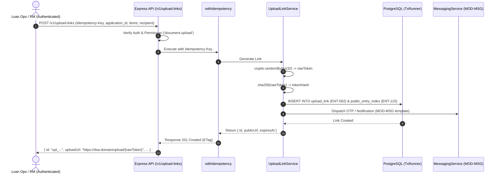
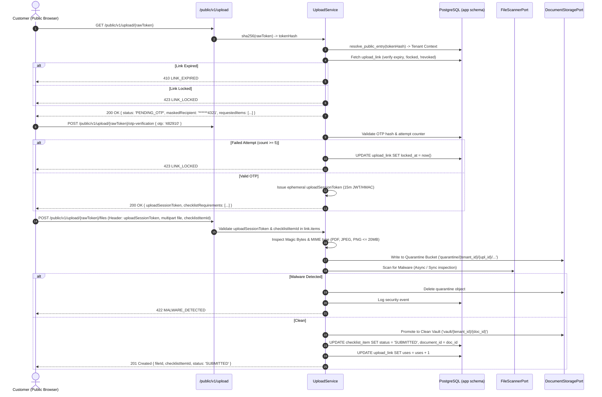
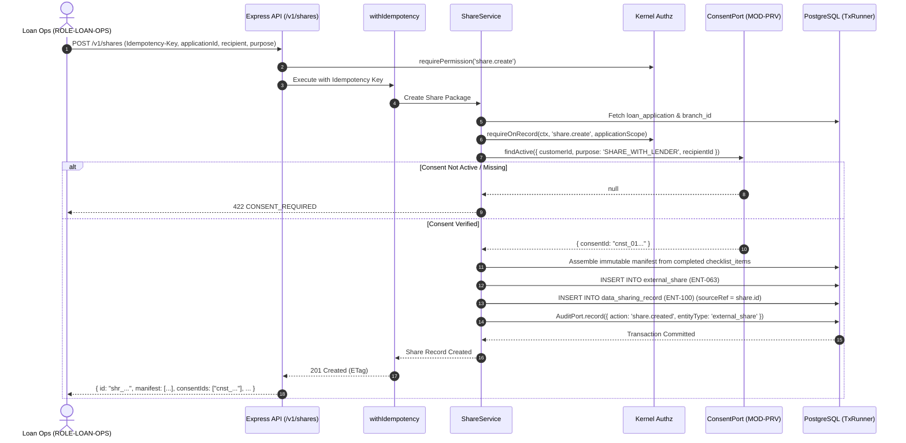
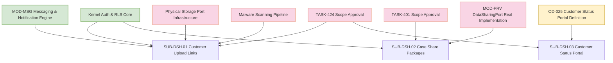

# Module 25: Document Sharing (MOD-DSH) — Implementation Readiness Assessment & Architectural Blueprint

**Document Reference:** `MOD_DSH_IMPLEMENTATION_READINESS.md`  
**Classification:** Confidential — System Architecture & Security Audit  
**Status:** **DEFERRED (Scope Frozen under TASK-424 & TASK-401)**  
**Author:** Senior Full-Stack Engineer & Security Architect  
**Target Release:** Post-Gate 1 / Phase 2 (Synthetic Data Only)  

---

## Executive Summary

Module 25 (Document Sharing — `MOD-DSH`) covers three capabilities within the DSA CRM:
1. **SUB-DSH.01: Customer Upload Links** (`TASK-424`, S1 classification, R-OPS operational risk)
2. **SUB-DSH.02: Case Share Packages** (`TASK-401`, S2 classification, R-LOAN risk)
3. **SUB-DSH.03: Customer Status Portal** (`TASK-424`, Open Decision `OD-025`)

**Critical Finding:** `MOD-DSH` is explicitly **Deferred** in the project charter. In accordance with strict project constraints, **no code has been implemented, no migrations have been executed, and no deferred features have been activated**. 

This document delivers a codebase audit of existing foundation components, identifies foundational gaps and hard dependencies, formalizes proposed architectural workflows, specifies API/Zod contracts, evaluates security and privacy threats, proposes necessary database migrations, outlines comprehensive test plans, and presents an actionable, phased implementation roadmap.

---

## 1. Existing Components Audit

A comprehensive audit of the active repository (`apps/api`, `apps/web`, `packages/contracts`, `packages/kernel`, `supabase/migrations`) was performed. The following foundational architectural components exist and must be reused rather than duplicated:

### 1.1 Tenancy, Authentication, and RLS Infrastructure
* **PostgreSQL RLS & Helper Functions:**
  * File: [`supabase/migrations/20261001000000_roles_and_helpers.sql`](file:///Users/prathameshnavangul/Piyush%20Qloxa/Qloax%20Project/DSA-Agent/supabase/migrations/20261001000000_roles_and_helpers.sql)
  * Implements `app_tenant()` reading `current_setting('app.tenant_id', true)`, `enable_tenant_rls(tbl regclass)`, `touch_row()`, and `forbid_mutation()`.
  * All application tables live in the `app` schema and connect via `dsa_api` (member of `dsa_app`, `NOBYPASSRLS`).
* **Transaction Runner (`TxRunner`):**
  * File: [`apps/api/src/kernel-min/tx-runner.ts`](file:///Users/prathameshnavangul/Piyush%20Qloxa/Qloax%20Project/DSA-Agent/apps/api/src/kernel-min/tx-runner.ts)
  * Executes all tenant-scoped database interactions inside `withTenantTx(ctx, fn)`, setting transaction-local `SET LOCAL app.tenant_id = ctx.principal.tenantId`.
* **RBAC & Authorization Engine (`Authz`):**
  * Files: [`packages/kernel/src/authz/authz.ts`](file:///Users/prathameshnavangul/Piyush%20Qloxa/Qloax%20Project/DSA-Agent/packages/kernel/src/authz/authz.ts), [`packages/contracts/src/kernel.ts`](file:///Users/prathameshnavangul/Piyush%20Qloxa/Qloax%20Project/DSA-Agent/packages/contracts/src/kernel.ts)
  * Implements `requirePermission(ctx, code)`, `requireOnRecord(ctx, code, rec)`, `scopeFilter(ctx, code, qb, cols)`, and `requireStepUp(ctx)`.
  * Canonical roles seeded in [`seeds/demo/platform.ts`](file:///Users/prathameshnavangul/Piyush%20Qloxa/Qloax%20Project/DSA-Agent/seeds/demo/platform.ts): `ROLE-ORG-OWNER` (tenant scope), `ROLE-BRANCH-MGR` (branch scope), `ROLE-LOAN-OPS` (branch scope).

### 1.2 Public Entry Resolution Infrastructure
* **Public Entry Table (`ENT-115 public_entry_index`) & Definer Function:**
  * File: [`supabase/migrations/20261001000006_messaging.sql#L117-L150`](file:///Users/prathameshnavangul/Piyush%20Qloxa/Qloax%20Project/DSA-Agent/supabase/migrations/20261001000006_messaging.sql#L117-L150)
  * Contains `public_entry_index` and PostgreSQL `SECURITY DEFINER` function `app.resolve_public_entry(p_connection_path_id text)`.
  * Used in [`apps/api/src/modules/crm/messaging/messaging-service.ts#L836-L860`](file:///Users/prathameshnavangul/Piyush%20Qloxa/Qloax%20Project/DSA-Agent/apps/api/src/modules/crm/messaging/messaging-service.ts#L836-L860) to resolve anonymous requests to a verified tenant context without trusting caller-supplied tenant IDs.
* **Public Routing Mount Point:**
  * File: [`apps/api/src/app.ts#L85-L90`](file:///Users/prathameshnavangul/Piyush%20Qloxa/Qloax%20Project/DSA-Agent/apps/api/src/app.ts#L85-L90)
  * Mounts unauthenticated routes under `/public/v1` with mandatory correlation ID and rate limiting.

### 1.3 Audit Logging and Idempotency
* **Audit Logging Engine (`AuditPort`):**
  * Files: [`packages/kernel/src/audit/audit.ts`](file:///Users/prathameshnavangul/Piyush%20Qloxa/Qloax%20Project/DSA-Agent/packages/kernel/src/audit/audit.ts), [`supabase/migrations/20261001000002_kernel_infra.sql#L33-L52`](file:///Users/prathameshnavangul/Piyush%20Qloxa/Qloax%20Project/DSA-Agent/supabase/migrations/20261001000002_kernel_infra.sql#L33-L52)
  * Implements transactional audit emission writing to `app.audit_event` in the caller's transaction.
* **Idempotency Engine (`withIdempotency`):**
  * Files: [`packages/kernel/src/idempotency/idempotency.ts`](file:///Users/prathameshnavangul/Piyush%20Qloxa/Qloax%20Project/DSA-Agent/packages/kernel/src/idempotency/idempotency.ts), [`supabase/migrations/20261001000002_kernel_infra.sql#L7-L17`](file:///Users/prathameshnavangul/Piyush%20Qloxa/Qloax%20Project/DSA-Agent/supabase/migrations/20261001000002_kernel_infra.sql#L7-L17)
  * Backed by `app.idempotency_key` table, enforcing replay semantics and detecting duplicate / reused keys.

### 1.4 Entities & Domain Services
* **Lead, Customer, and Contact Entities:**
  * File: [`supabase/migrations/20261001000003_crm_leads_customers.sql`](file:///Users/prathameshnavangul/Piyush%20Qloxa/Qloax%20Project/DSA-Agent/supabase/migrations/20261001000003_crm_leads_customers.sql)
  * Defines `customer` (ENT-025), `customer_contact_point` (ENT-026 with HMAC-SHA256 `value_hash`), and `consent_record` (ENT-028).
* **Loan Applications & Document Checklists:**
  * File: [`supabase/migrations/20261001000021_origination_application.sql`](file:///Users/prathameshnavangul/Piyush%20Qloxa/Qloax%20Project/DSA-Agent/supabase/migrations/20261001000021_origination_application.sql)
  * Defines `loan_application` (ENT-045) and `checklist_item` (ENT-048).
  * Line 100 explicitly anticipates document integration: `document_id text, -- populated by TASK-401`.
* **Data Sharing Inventory (`ENT-100 data_sharing_record`):**
  * File: [`supabase/migrations/20261001000003_crm_leads_customers.sql#L195-L210`](file:///Users/prathameshnavangul/Piyush%20Qloxa/Qloax%20Project/DSA-Agent/supabase/migrations/20261001000003_crm_leads_customers.sql#L195-L210)
  * Implements append-only table `app.data_sharing_record` (FR-PRV-007) with tenant RLS.
* **Messaging & Communication (MOD-MSG):**
  * Files: [`apps/api/src/modules/crm/messaging/messaging-service.ts`](file:///Users/prathameshnavangul/Piyush%20Qloxa/Qloax%20Project/DSA-Agent/apps/api/src/modules/crm/messaging/messaging-service.ts), [`apps/api/src/modules/crm/messaging/send-guard.ts`](file:///Users/prathameshnavangul/Piyush%20Qloxa/Qloax%20Project/DSA-Agent/apps/api/src/modules/crm/messaging/send-guard.ts)
  * Implements dispatch, templates (`app.message_template`), messages (`app.message`), and privacy/consent guards.

---

## 2. Missing Components & Architectural Blockers

The audit revealed 8 significant architectural gaps that must be resolved prior to implementing `MOD-DSH`:

| # | Missing Component / Gap | Impact on MOD-DSH | Target Resolution / Remediation |
|---|-------------------------|-------------------|---------------------------------|
| **GAP-1** | **Entity `ENT-062 upload_link`** | Blocks SUB-DSH.01 link creation, storage, and OTP verification. | Propose Migration `M-025` with `upload_link` table, tenant RLS, and touch triggers. |
| **GAP-2** | **Entity `ENT-063 external_share`** | Blocks SUB-DSH.02 case share packaging. | Propose Migration `M-025` with `external_share` table, tenant RLS, and touch triggers. |
| **GAP-3** | **Check Constraint Mismatch on `ENT-100 data_sharing_record`** | In `M-003`, `data_sharing_record` is constrained to `recipient_type IN ('LENDER')` and `purpose IN ('LENDER_SUBMISSION')`. SUB-DSH.02 requires generic external shares (e.g. auditor, partner, co-lender). | Propose migration to expand `recipient_type` and `purpose` enum checks on `data_sharing_record`. |
| **GAP-4** | **`ENT-115 public_entry_index` Schema Limitation** | `public_entry_index` in `M-006` was designed specifically for webhook paths (`provider`, `connection_id`, `signing_secret`). It lacks a `kind` column to support `UPLOAD_LINK` or `STATUS_PORTAL` tokens. | Propose adding `kind` column (`WEBHOOK`, `UPLOAD_LINK`, `STATUS_PORTAL`) and target record reference columns to `public_entry_index`. |
| **GAP-5** | **Physical Document Storage Infrastructure** | Supabase Storage is explicitly disabled in [`supabase/config.toml#L117-L119`](file:///Users/prathameshnavangul/Piyush%20Qloxa/Qloax%20Project/DSA-Agent/supabase/config.toml#L117-L119) (`[storage] enabled = false`), and `ADR-SB-04` mandates that Express is the only business layer. No S3/Blob store adapter exists. | Define an abstract `DocumentStoragePort` (S3/local MinIO in dev, AWS S3/Azure Blob in prod). Storage configuration must remain outside git. |
| **GAP-6** | **File Scanning & Antivirus Pipeline** | No malware scanning pipeline (ClamAV, VirusTotal, or AWS GuardDuty S3 scanning) exists. | Define a quarantine workflow: files upload to a quarantine bucket/state, trigger `ScanDocumentPort`, and are released to safe storage only upon receiving `CLEAN` attestation. |
| **GAP-7** | **Permissions & Roles Gap** | `document.upload` and `share.create` do not exist in [`packages/contracts/src/permissions.ts`](file:///Users/prathameshnavangul/Piyush%20Qloxa/Qloax%20Project/DSA-Agent/packages/contracts/src/permissions.ts) or in `permission` seed table. Neither `ROLE-ORG-OWNER`, `ROLE-BRANCH-MGR`, nor `ROLE-LOAN-OPS` possess them. | Add permission codes to `contracts/permissions.ts` and add SQL seed rows in `M-025`. |
| **GAP-8** | **HTTP Error Code 410 Gap** | The specification requires `410 LINK_EXPIRED`. In [`packages/contracts/src/errors.ts`](file:///Users/prathameshnavangul/Piyush%20Qloxa/Qloax%20Project/DSA-Agent/packages/contracts/src/errors.ts), `ERROR_HTTP_STATUS` has no 410 mapping and no `LINK_EXPIRED` code. | Add `LINK_EXPIRED: 410` and `LINK_LOCKED: 423` to `ERROR_HTTP_STATUS` in `packages/contracts/src/errors.ts`. |

---

## 3. Submodule Architectural Designs & Request Flows

### 3.1 SUB-DSH.01: Customer Upload Links

#### Architectural Principles
1. **Zero Knowledge / Opaque Public Token:** The raw public token (minimum 256 bits of CSPRNG entropy) is never stored in the database. Only its cryptographic hash (`SHA-256`) is stored in `ENT-062 upload_link.token_hash`.
2. **Zero Information Disclosure Pre-Verification:** Calling `GET /public/v1/upload/{token}` returns **no customer names, no contact details, no loan amounts, and no lender details**. It returns only link status, whether OTP is required, a masked contact hint (e.g., `+91 ******1234`), and the list of requested checklist requirement types.
3. **Strict OTP Lifecycle & Lockout:** OTPs are 6-digit cryptographic digits with 10-minute validity. A maximum of 5 failed attempts is strictly enforced; exceeding 5 attempts sets `locked_at = now()`, permanently locking the link until staff intervention.
4. **Tenant Resolution via `ENT-115`:** The public router maps `token_hash` to `tenant_id` via `resolve_public_entry`, establishing a clean tenant context before executing any queries.
5. **Requested Items Restriction:** Uploads must specify `checklistItemId`. The server validates that each item belongs to the application and is still in `PENDING` or `REJECTED` status.

#### Sequence Flow: Link Generation & Delivery


#### Sequence Flow: Public Verification & File Ingestion


---

### 3.2 SUB-DSH.02: Case Share Packages

#### Architectural Principles
1. **Verified Consent Gate (Non-Bypassable):** The caller cannot simply supply a `consent_id`. The server invokes `ConsentPort.findActive(tx, { customerId, purpose: 'SHARE_WITH_LENDER', purposeTarget: lenderId })`. If no active, unexpired, non-withdrawn consent exists, the request fails with `422 CONSENT_REQUIRED`.
2. **Immutable Share Manifest:** At creation time, the manifest of application facts and document references is frozen into a JSONB document. Once created, the manifest cannot be altered.
3. **Atomic `ENT-100` Ingestion:** Creating an `external_share` (ENT-063) must write an `app.data_sharing_record` (ENT-100) and an `app.audit_event` in the **exact same database transaction**.
4. **Scope-Bound Access:** `ROLE-ORG-OWNER` has tenant-wide sharing visibility; `ROLE-BRANCH-MGR` and `ROLE-LOAN-OPS` are strictly limited to their branch scope using `Authz.requireOnRecord`.
5. **Cursor-Paginated & Privacy-Safe:** `GET /v1/shares` strips sensitive recipient tokens and credentials, returning only metadata, access counts, and manifest item keys.

#### Sequence Flow: Case Share Package Generation


---

### 3.3 SUB-DSH.03: Customer Status Portal (Architecture Proposal for OD-025)

The Customer Status Portal is currently an unresolved product decision (`OD-025`) and deferred under `TASK-424`.

#### 1. Open Architectural & Security Decisions
* **Decision 1: Data Exposure Boundary:**
  * *Option A (Minimal):* Expose high-level milestone status only (`DOCUMENTS_PENDING`, `UNDER_REVIEW`, `SUBMITTED_TO_LENDER`, `SANCTIONED`, `DISBURSED`). Mask all lender identities, internal credit scores, rejection reasons, and margin percentages.
  * *Option B (Full Application View):* Expose lender name, requested amount, sanction letter download, and query comments.
  * *Architectural Recommendation:* **Option A**. Exposing lender-specific credit rationale or internal notes creates severe compliance and competitive risk.
* **Decision 2: Authentication Model:**
  * *Option A (Reusing Upload Links):* A single link acts as both status portal and document upload portal.
  * *Option B (Independent Read-Only Portal Token):* Decoupled token model.
  * *Architectural Recommendation:* **Option B (Decoupled)**. Upload links have destructive write capabilities (`max_uses`, upload state). Conflating a customer status viewer with an upload link creates permission confusion and complicates usage-limit tracking.
* **Decision 3: Co-Applicant & Multi-Party Privacy:**
  * Loan applications frequently contain multiple parties (Primary Applicant, Co-Applicant, Guarantor).
  * *Security Mandate:* A status link issued to the primary borrower must **never** disclose the PAN, personal contact details, or individual checklist attestations of the co-applicant without explicit multi-party consent.

#### 2. Scope Guard
> [!IMPORTANT]
> **Implementation Prohibition:** In strict adherence to project constraints, **no endpoints, database schemas, or frontend pages shall be created for SUB-DSH.03** until `OD-025` is formally approved by Product Management and Security Architecture.

---

## 4. Proposed API Contracts & Validation

The proposed contracts adhere to the shared contract conventions in `packages/contracts` (prefixed ULIDs, ISO 8601 UTC dates, `Idempotency-Key` headers, and canonical error envelopes).

### 4.1 SUB-DSH.01 Contracts

#### 1. `POST /v1/upload-links` (API-DSH-001)
* **Headers:** `Authorization: Bearer <jwt>`, `Idempotency-Key: <ulid|uuid>` (Required)
* **Permissions:** `document.upload` at `BRANCH` or `TENANT` scope
* **Zod Input Schema:**
```typescript
export const CreateUploadLinkSchema = z.object({
  applicationId: IdSchema('app'),
  recipientContactId: IdSchema('ccp'),
  checklistItemIds: z.array(IdSchema('chk')).min(1).max(20),
  expiresInHours: z.number().int().min(1).max(168).default(48), // Max 7 days
  maxUses: z.number().int().min(1).max(50).default(5),
  otpRequired: z.boolean().default(true),
});
```
* **Response (201 Created):**
```json
{
  "id": "upl_01JTESTUPLOADLINK000000001",
  "applicationId": "app_01JTESTAPP00000000000001",
  "uploadUrl": "https://dsa.domain/upload/v1_7e9a8fbc... (raw token displayed once)",
  "items": ["chk_01JTESTCHK0000000000001"],
  "expiresAt": "2026-10-15T10:00:00Z",
  "maxUses": 5,
  "uses": 0,
  "otpRequired": true,
  "createdAt": "2026-10-13T10:00:00Z"
}
```

#### 2. `POST /v1/upload-links/{id}/revocation` (API-DSH-002)
* **Headers:** `Authorization: Bearer <jwt>`, `If-Match: "<lockVersion>"`
* **Permissions:** `document.upload`
* **Response (200 OK):** Returns updated `upload_link` with `revokedAt: "2026-10-13T10:30:00Z"`.

#### 3. `GET /public/v1/upload/{token}` (API-DSH-003)
* **Headers:** Rate-limited by IP (60 req/min)
* **Response (200 OK — Pre-Verification Shape):**
```json
{
  "status": "OTP_REQUIRED",
  "expiresAt": "2026-10-15T10:00:00Z",
  "maskedContact": "+91 ******9876",
  "requestedItemTypes": [
    { "checklistItemId": "chk_01J...", "documentTypeCode": "BANK_STATEMENT", "ordinal": 1 }
  ]
}
```
* **Error Behaviors:**
  * `410 LINK_EXPIRED`: `expiresAt < now()`
  * `423 LINK_LOCKED`: `locked_at IS NOT NULL`
  * `404 NOT_FOUND`: Token hash not in `public_entry_index`

#### 4. `POST /public/v1/upload/{token}/otp-verification` (API-DSH-004)
* **Zod Input Schema:**
```typescript
export const VerifyUploadOtpSchema = z.object({
  otp: z.string().regex(/^\d{6}$/, 'OTP must be 6 digits'),
});
```
* **Response (200 OK):**
```json
{
  "uploadSessionToken": "eyJhbGciOi...",
  "sessionExpiresAt": "2026-10-13T10:45:00Z",
  "applicationReference": "APP-2026-MUM",
  "items": [
    { "checklistItemId": "chk_01J...", "documentTypeCode": "BANK_STATEMENT", "mandatory": true }
  ]
}
```
* **Lockout Behavior:** 5 consecutive failures sets `locked_at` on `upload_link` and returns `423 LINK_LOCKED`.

#### 5. `POST /public/v1/upload/{token}/files` (API-DSH-005)
* **Headers:** `Authorization: Bearer <uploadSessionToken>`, `Content-Type: multipart/form-data`
* **Form Payload:** `file: <binary>`, `checklistItemId: <id>`
* **Validation:** Max file size 20MB. Allowed MIME: `application/pdf`, `image/jpeg`, `image/png`.
* **Response (201 Created):**
```json
{
  "documentId": "doc_01JTESTDOC0000000000001",
  "checklistItemId": "chk_01JTESTCHK0000000000001",
  "status": "SUBMITTED",
  "filename": "statement_apr_sep.pdf",
  "uploadedAt": "2026-10-13T10:35:00Z"
}
```

---

### 4.2 SUB-DSH.02 Contracts

#### 1. `POST /v1/shares` (API-DSH-006)
* **Headers:** `Authorization: Bearer <jwt>`, `Idempotency-Key: <ulid|uuid>` (Required)
* **Permissions:** `share.create` (at `BRANCH` or `TENANT` scope)
* **Zod Input Schema:**
```typescript
export const CreateShareSchema = z.object({
  applicationId: IdSchema('app'),
  recipientType: z.enum(['LENDER', 'CO_LENDER', 'PARTNER', 'AUDITOR']),
  recipientId: z.string().min(1).max(100),
  recipientContact: z.object({
    name: z.string().min(2).max(100),
    email: z.string().email(),
  }),
  purpose: z.enum(['LENDER_SUBMISSION', 'PORTFOLIO_REVIEW', 'AUDIT_INSPECTION']),
  expiresInDays: z.number().int().min(1).max(30).default(7),
  checklistItemIds: z.array(IdSchema('chk')).min(1),
});
```
* **Validation & Gates:** Server checks active consent for customer and purpose. Rejects with `422 CONSENT_REQUIRED` if unverified.
* **Response (201 Created):** Returns `external_share` record with `id: "shr_..."`, immutable manifest, and `dataSharingRecordId: "dsr_..."`.

#### 2. `POST /v1/shares/{id}/revocation` (API-DSH-007)
* **Headers:** `Authorization: Bearer <jwt>`, `If-Match: "<lockVersion>"`
* **Permissions:** `share.create`
* **Response (200 OK):** Sets `revoked_at = now()`.

#### 3. `GET /v1/shares?subjectType=&subjectId=` (API-DSH-008)
* **Headers:** `Authorization: Bearer <jwt>`
* **Query Parameters:** `subjectType=LOAN_APPLICATION`, `subjectId=<id>`, `limit=50`, `cursor=<ulid>`
* **Permissions:** `customer.read`
* **Response (200 OK):** Cursor-paginated array `{ data: [...], meta: { nextCursor, limit } }`.

---

## 5. Security and Privacy Threat Analysis

A threat modeling exercise based on STRIDE and OWASP Top 10 API Security was conducted:

| Threat Category | Identified Vulnerability / Attack Vector | Mitigation Strategy & Security Controls |
|---|---|---|
| **Information Disclosure** | Unauthenticated callers enumerating upload links via brute force or predictive IDs. | 1. Tokens use 256 bits of entropy (`crypto.randomBytes(32)`).<br>2. Store only `SHA-256(rawToken)` in database.<br>3. `GET /public/v1/upload/{token}` returns **zero PII** prior to OTP verification.<br>4. IP rate-limiting on public routes. |
| **Authentication Bypass** | OTP brute forcing on public links. | 1. 6-digit numeric OTP expires in 10 minutes.<br>2. Strict lock at 5 failed attempts (`locked_at = now()`).<br>3. OTP verification issues short-lived session token (15m JWT) bound to link. |
| **Tenant Isolation Leak** | Attackers manipulating caller-supplied tenant IDs or headers on public routes. | 1. Public endpoints **never** accept `tenant_id` from query, body, or headers.<br>2. Tenant context is resolved strictly via `SECURITY DEFINER` function `resolve_public_entry(token_hash)`.<br>3. `TxRunner.withTenantTx` enforces PostgreSQL RLS on all queries. |
| **Consent Bypass** | Client submitting false `consent_ids` during share generation. | 1. Server ignores client-supplied `consent_ids`.<br>2. Server queries `ConsentPort.findActive` directly in the request transaction.<br>3. Rejects with `422 CONSENT_REQUIRED` if consent is absent, expired, or withdrawn. |
| **Malware & File Upload Exploits** | Malicious file execution, zip bombs, executable MIME masquerading. | 1. Multipart stream inspects magic bytes (rejects mismatches between extension and binary signature).<br>2. Files land in isolated **Quarantine Storage**.<br>3. ClamAV / GuardDuty scan before promotion to clean document vault.<br>4. Rejection of all S3-class unredacted data (ADR-4D-04). |
| **Race Conditions & Concurrency** | Double submission of files exceeding `max_uses`. | 1. Database row locking (`SELECT ... FOR UPDATE`) on `upload_link` during file ingestion.<br>2. Check constraint: `CHECK (uses <= max_uses)`. |
| **Logging & PII Exposure** | Tokens, OTPs, or customer PII leaking into server logs. | 1. Pino logger serializer configured to scrub request bodies, query params, and authorization headers.<br>2. Tokens and OTPs must never appear in `audit_event.before` or `after` JSONB. |

---

## 6. Proposed Database Migrations & Entities

> [!NOTE]
> **Proposed DDL Only:** The SQL below is strictly proposed and documented for implementation readiness. In compliance with project constraints, **no migration files have been created in `supabase/migrations`**.

### 6.1 Proposed Migration: `20261001000025_document_sharing_core.sql`

```sql
-- Migration M-025: Document Sharing Module (MOD-DSH)
-- Owner: Dev 1 / Dev 3
SET search_path = app, extensions, public;

-- 1. New Permissions
INSERT INTO permission (code, description, introduced_in) VALUES
  ('document.upload', 'Generate and revoke customer document upload links', 'POST-MVP'),
  ('share.create', 'Create and revoke third-party case share packages', 'POST-MVP')
ON CONFLICT (code) DO NOTHING;

-- Grant permissions to core roles
INSERT INTO role_permission (tenant_id, role_id, permission_code)
SELECT r.tenant_id, r.id, 'share.create'
FROM app.role r WHERE r.code IN ('ROLE-ORG-OWNER', 'ROLE-BRANCH-MGR', 'ROLE-LOAN-OPS')
ON CONFLICT DO NOTHING;

INSERT INTO role_permission (tenant_id, role_id, permission_code)
SELECT r.tenant_id, r.id, 'document.upload'
FROM app.role r WHERE r.code IN ('ROLE-ORG-OWNER', 'ROLE-BRANCH-MGR', 'ROLE-LOAN-OPS')
ON CONFLICT DO NOTHING;

-- 2. Expand ENT-115 public_entry_index for UPLOAD_LINK kind
ALTER TABLE public_entry_index 
  ADD COLUMN IF NOT EXISTS kind text NOT NULL DEFAULT 'WEBHOOK' CHECK (kind IN ('WEBHOOK', 'UPLOAD_LINK', 'STATUS_PORTAL')),
  ADD COLUMN IF NOT EXISTS target_id text;

-- 3. ENT-062: upload_link
CREATE TABLE IF NOT EXISTS upload_link (
  id                    text PRIMARY KEY,
  tenant_id             text NOT NULL REFERENCES tenant(id),
  application_id        text NOT NULL,
  token_hash            text NOT NULL UNIQUE,
  items                 text[] NOT NULL CHECK (cardinality(items) > 0),
  recipient_contact_id  text NOT NULL,
  expires_at            timestamptz NOT NULL,
  otp_required          boolean NOT NULL DEFAULT true,
  otp_hash              text,
  otp_expires_at        timestamptz,
  failed_attempts       smallint NOT NULL DEFAULT 0,
  max_uses              smallint NOT NULL DEFAULT 5 CHECK (max_uses >= 1),
  uses                  smallint NOT NULL DEFAULT 0 CHECK (uses >= 0),
  revoked_at            timestamptz,
  revoked_by            text,
  locked_at             timestamptz,
  lock_version          integer NOT NULL DEFAULT 0,
  created_at            timestamptz NOT NULL DEFAULT now(),
  created_by            text NOT NULL,
  updated_at            timestamptz NOT NULL DEFAULT now(),
  updated_by            text NOT NULL,
  UNIQUE (tenant_id, id),
  FOREIGN KEY (tenant_id, application_id) REFERENCES loan_application (tenant_id, id),
  FOREIGN KEY (tenant_id, recipient_contact_id) REFERENCES customer_contact_point (tenant_id, id),
  CHECK (uses <= max_uses)
);

CREATE INDEX IF NOT EXISTS upload_link_app_idx ON upload_link (tenant_id, application_id, created_at DESC);
CREATE INDEX IF NOT EXISTS upload_link_token_hash_idx ON upload_link (token_hash);

CREATE TRIGGER upload_link_touch BEFORE UPDATE ON upload_link FOR EACH ROW EXECUTE FUNCTION touch_row();
CALL enable_tenant_rls('upload_link');
GRANT SELECT, INSERT, UPDATE ON upload_link TO dsa_app;

-- 4. ENT-063: external_share
CREATE TABLE IF NOT EXISTS external_share (
  id                    text PRIMARY KEY,
  tenant_id             text NOT NULL REFERENCES tenant(id),
  application_id        text NOT NULL,
  recipient_type        text NOT NULL CHECK (recipient_type IN ('LENDER', 'CO_LENDER', 'PARTNER', 'AUDITOR')),
  recipient_id          text NOT NULL,
  recipient_contact     jsonb NOT NULL CHECK (jsonb_typeof(recipient_contact) = 'object'),
  purpose               text NOT NULL CHECK (purpose IN ('LENDER_SUBMISSION', 'PORTFOLIO_REVIEW', 'AUDIT_INSPECTION')),
  consent_ids           text[] NOT NULL CHECK (cardinality(consent_ids) > 0),
  manifest              jsonb NOT NULL CHECK (jsonb_typeof(manifest) = 'object'),
  expires_at            timestamptz NOT NULL,
  revoked_at            timestamptz,
  revoked_by            text,
  access_count          integer NOT NULL DEFAULT 0 CHECK (access_count >= 0),
  lock_version          integer NOT NULL DEFAULT 0,
  created_at            timestamptz NOT NULL DEFAULT now(),
  created_by            text NOT NULL,
  updated_at            timestamptz NOT NULL DEFAULT now(),
  updated_by            text NOT NULL,
  UNIQUE (tenant_id, id),
  FOREIGN KEY (tenant_id, application_id) REFERENCES loan_application (tenant_id, id)
);

CREATE INDEX IF NOT EXISTS external_share_app_idx ON external_share (tenant_id, application_id, created_at DESC);
CREATE TRIGGER external_share_touch BEFORE UPDATE ON external_share FOR EACH ROW EXECUTE FUNCTION touch_row();
CALL enable_tenant_rls('external_share');
GRANT SELECT, INSERT, UPDATE ON external_share TO dsa_app;

-- 5. Expand ENT-100 data_sharing_record check constraints
ALTER TABLE data_sharing_record 
  DROP CONSTRAINT IF EXISTS data_sharing_record_recipient_type_check,
  DROP CONSTRAINT IF EXISTS data_sharing_record_purpose_check;

ALTER TABLE data_sharing_record
  ADD CONSTRAINT data_sharing_record_recipient_type_check 
    CHECK (recipient_type IN ('LENDER', 'CO_LENDER', 'PARTNER', 'AUDITOR')),
  ADD CONSTRAINT data_sharing_record_purpose_check 
    CHECK (purpose IN ('LENDER_SUBMISSION', 'PORTFOLIO_REVIEW', 'AUDIT_INSPECTION'));
```

---

## 7. Comprehensive Test Plans

### 7.1 Unit Tests (Vitest)
* `upload-token.spec.ts`:
  * Validates entropy of generated tokens (256 bits).
  * Validates constant-time equality checks and SHA-256 hash reproducibility.
* `otp-lockout.spec.ts`:
  * Verifies attempt counter increments on bad OTP.
  * Verifies lockout trigger on exactly 5 failures.
* `share-manifest.spec.ts`:
  * Verifies manifest deep freeze and immutability.
  * Ensures S3-class fields (PAN, Aadhaar) are rejected from manifest.

### 7.2 Integration Tests (PostgreSQL + Supertest)
* `upload-links.pg.int.spec.ts`:
  * `API-DSH-001`: Create upload link inside tenant transaction with `Idempotency-Key`.
  * `API-DSH-002`: Revoke link; ensure subsequent public resolution returns `404` or `410`.
  * `API-DSH-003`: Public resolution returns pre-verification payload without PII.
  * `API-DSH-004`: Successful OTP returns upload session token; wrong OTP fails.
  * `API-DSH-005`: Multi-file upload updates `checklist_item.document_id` and increments `uses`.
* `external-shares.pg.int.spec.ts`:
  * `API-DSH-006`: Atomic insertion of `external_share` and `data_sharing_record`.
  * Verify failure with `422 CONSENT_REQUIRED` when consent is withdrawn or expired.

### 7.3 Tenant Isolation Tests (`TEST-SEC-001`)
* File: `tests/isolation/cases/document-sharing.spec.ts`
* **Test Case 1 (Cross-Tenant Token Probing):** Tenant B attempts to resolve Tenant A's token hash via public endpoint. Public resolver strictly sets Tenant A's context, preventing Tenant B's staff from seeing or modifying Tenant A's link.
* **Test Case 2 (Cross-Tenant Share Access):** Tenant B attempts to fetch Tenant A's shares via `GET /v1/shares?subjectId=<TenantA_AppId>`. Returns `404 NOT_FOUND` (never 403, preventing existence disclosure).
* **Test Case 3 (RLS Leak Check):** Direct query as `dsa_api` with `app.tenant_id = 'tenant_b'` returns 0 rows on `upload_link` and `external_share` created by Tenant A.

### 7.4 Concurrency & Race Condition Tests
* Concurrent file upload simulation: 10 concurrent requests attempting to upload against a link with `max_uses = 1`. Exactly 1 request succeeds; 9 requests fail with `409` or `422 USAGE_LIMIT_EXCEEDED`.
* Concurrent OTP brute force: 10 parallel incorrect OTP requests must lock the link and record 5 failures, never allowing execution past the lock barrier.

---

## 8. Dependency Blockers & Unresolved Decisions

Prior to implementing `MOD-DSH`, the following project-level blockers must be resolved and signed off:



1. **Unblock Task Approvals:**
   * `TASK-424` (Customer Upload Links & Status Portal) is currently deferred. Explicit Product Architecture sign-off is required.
   * `TASK-401` (Origination Case Shares & Document Engine) is currently deferred.
2. **Storage Architecture (`DocumentStoragePort`):**
   * Express modular monolith currently has no object storage. An abstraction layer must be agreed upon:
     - Local development: MinIO container or local filesystem vault with simulated signed URLs.
     - Cloud deployment: AWS S3 / Cloudflare R2 with IAM-restricted upload policies.
3. **Malware Scanning Provider:**
   * Antivirus service selection (ClamAV container vs. cloud provider native scanner) must be approved.
4. **MOD-PRV `DataSharingPort` Implementation:**
   * Currently, only `FakeDataSharingPort` exists. Dev 5 must deliver the real `DataSharingPort` inside `apps/api/src/modules/compliance` to satisfy the architectural boundary rule.
5. **Open Decision `OD-025`:**
   * Product definition required for data exposure limits on the Customer Status Portal.

---

## 9. Phased Implementation Roadmap & Effort Estimation

Total estimated effort: **8.5 Developer-Days (17 Story Points)** across 4 distinct phases following project unblocking:

```
+-------------------------------------------------------------------------------+
| PHASE 1: Core Foundation & Contracts (2 Days)                                 |
| - Extend packages/contracts (Zod schemas, permissions, 410 error code)        |
| - Create Migration M-025 (upload_link, external_share, public_entry_index)    |
| - Implement DocumentStoragePort & FakeDocumentStoragePort                     |
+-------------------------------------------------------------------------------+
                                      |
                                      v
+-------------------------------------------------------------------------------+
| PHASE 2: SUB-DSH.01 Customer Upload Links (2.5 Days)                          |
| - Implement UploadLinkService & OTP dispatch via MOD-MSG                      |
| - Build public endpoints (/public/v1/upload/...)                              |
| - Integrate file streaming, quarantine, and FileScannerPort                   |
| - Add integration tests & TEST-SEC-001 isolation suite                        |
+-------------------------------------------------------------------------------+
                                      |
                                      v
+-------------------------------------------------------------------------------+
| PHASE 3: SUB-DSH.02 Case Share Packages (2 Days)                              |
| - Integrate with real DataSharingPort & ConsentPort                           |
| - Build POST /v1/shares with immutable manifest generator                     |
| - Implement atomic ENT-100 data_sharing_record creation                       |
| - Add cursor pagination & branch-scoping filters                              |
+-------------------------------------------------------------------------------+
                                      |
                                      v
+-------------------------------------------------------------------------------+
| PHASE 4: Frontend Web Features & OD-025 Status Portal (2 Days)                |
| - Customer-facing public responsive upload form (React 18 + Vite)             |
| - Staff document sharing & package management panel                           |
| - Resolve OD-025 and implement read-only status portal                        |
+-------------------------------------------------------------------------------+
```

---

## 10. Architectural Traceability Matrix

| Feature / Requirement | Current Codebase Status | Existing File Reference | Proposed File / Action Required |
|---|---|---|---|
| **Tenant Isolation & RLS** | **Implemented** | [`supabase/migrations/20261001000000_roles_and_helpers.sql`](file:///Users/prathameshnavangul/Piyush%20Qloxa/Qloax%20Project/DSA-Agent/supabase/migrations/20261001000000_roles_and_helpers.sql) | Apply `enable_tenant_rls` on proposed tables |
| **Transaction Runner** | **Implemented** | [`apps/api/src/kernel-min/tx-runner.ts`](file:///Users/prathameshnavangul/Piyush%20Qloxa/Qloax%20Project/DSA-Agent/apps/api/src/kernel-min/tx-runner.ts) | Wrap all DSH mutations in `withTenantTx` |
| **Audit Logging** | **Implemented** | [`packages/kernel/src/audit/audit.ts`](file:///Users/prathameshnavangul/Piyush%20Qloxa/Qloax%20Project/DSA-Agent/packages/kernel/src/audit/audit.ts) | Emit `upload_link.created`, `share.created` |
| **Idempotency** | **Implemented** | [`packages/kernel/src/idempotency/idempotency.ts`](file:///Users/prathameshnavangul/Piyush%20Qloxa/Qloax%20Project/DSA-Agent/packages/kernel/src/idempotency/idempotency.ts) | Wrap API-DSH-001 and API-DSH-006 |
| **Public Entry Resolution** | **Partial (Webhooks only)** | [`supabase/migrations/20261001000006_messaging.sql`](file:///Users/prathameshnavangul/Piyush%20Qloxa/Qloax%20Project/DSA-Agent/supabase/migrations/20261001000006_messaging.sql) | Add `kind` column and support `UPLOAD_LINK` |
| **OTP Delivery Engine** | **Implemented** | [`apps/api/src/modules/crm/messaging/messaging-service.ts`](file:///Users/prathameshnavangul/Piyush%20Qloxa/Qloax%20Project/DSA-Agent/apps/api/src/modules/crm/messaging/messaging-service.ts) | Register OTP message template |
| **Consent Verification** | **Implemented (CustomerService)** | [`apps/api/src/modules/crm/customers/customer-service.ts`](file:///Users/prathameshnavangul/Piyush%20Qloxa/Qloax%20Project/DSA-Agent/apps/api/src/modules/crm/customers/customer-service.ts) | Call `ConsentPort.findActive` |
| **Data Sharing Inventory** | **Partial (Fake only)** | [`packages/contracts/src/fakes/fake-data-sharing.ts`](file:///Users/prathameshnavangul/Piyush%20Qloxa/Qloax%20Project/DSA-Agent/packages/contracts/src/fakes/fake-data-sharing.ts) | Dev 5 to implement real `DataSharingPort` |
| **Object Storage** | **Missing (Disabled)** | [`supabase/config.toml`](file:///Users/prathameshnavangul/Piyush%20Qloxa/Qloax%20Project/DSA-Agent/supabase/config.toml) (`enabled = false`) | Implement `DocumentStoragePort` |
| **Malware Scanner** | **Missing** | *None* | Implement `FileScannerPort` with quarantine |
| **`ENT-062 upload_link`** | **Missing** | *None* | Proposed Migration `M-025` |
| **`ENT-063 external_share`**| **Missing** | *None* | Proposed Migration `M-025` |
| **Error Code `410`** | **Missing** | [`packages/contracts/src/errors.ts`](file:///Users/prathameshnavangul/Piyush%20Qloxa/Qloax%20Project/DSA-Agent/packages/contracts/src/errors.ts) | Add `LINK_EXPIRED: 410` to `ERROR_HTTP_STATUS` |
| **Customer Status Portal** | **Unresolved (OD-025)** | *None* | Require Product & Security sign-off |

---

## 11. Conclusion & Immediate Recommendations

Module 25 (`MOD-DSH`) has a sound architectural home within the DSA CRM modular monolith. The tenancy, authorization, RLS, audit, and messaging infrastructure provide robust primitives. 

However, **implementation cannot proceed safely** until the following 4 immediate actions occur:
1. **Scope Authorization:** Unblock `TASK-424` and `TASK-401`.
2. **Storage Decision:** Agree on the file storage provider and quarantine architecture.
3. **Consent & Sharing Port:** Complete the real `DataSharingPort` in `apps/api/src/modules/compliance`.
4. **Resolution of OD-025:** Finalize the customer status portal privacy and authentication policy.
