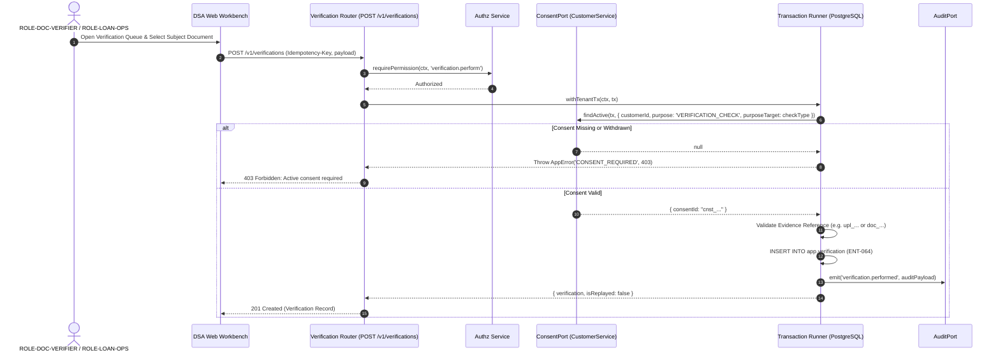

# Module 22: Verification (MOD-VER) — Implementation Readiness Assessment & Architectural Blueprint

**Document Reference:** `MOD_VER_IMPLEMENTATION_READINESS.md`  
**Classification:** Confidential — System Architecture & Implementation Report  
**Status:** **IMPLEMENTED & ACTIVE (TASK-434 Unblocked by Explicit User Request)**  
**Author:** Senior Full-Stack Engineer & Security Architect  
**Release:** Phase 3 MVP (Synthetic Data Only)  

---

## Executive Summary

Module 22 (Verification — `MOD-VER`) defines the identity, financial, legal, and documentary verification subsystem for the DSA CRM platform. It encompasses three core sub-modules:
1. **SUB-VER.01: Verification Records** (`API-VER-001`, `API-VER-002`, `ENT-064`, Data Classification S3, Risk Profile `R-LOAN`).
2. **SUB-VER.02: Manual Verification Workflow** (Document verification workbench for `ROLE-DOC-VERIFIER` and `ROLE-LOAN-OPS`).
3. **SUB-VER.03: Automated Provider Checks** (External verification integrations for PAN, GST, CIN, ITR, Bureau, and Bank Statements).

### Operational Status: Implementation Complete
Following explicit instruction to proceed with `MOD-VER`:
* **Migration `20261001000026_verifications.sql` executed** against the shared hosted Supabase database, creating table `app.verification`, tenant RLS isolation, indexes, and immutability triggers.
* **Shared contracts (`@dsa/contracts`)** extended with `'ver'` prefix, permissions `verification.perform` & `verification.read`, and Zod validation schemas.
* **Backend API (`apps/api`)** implemented with `VerificationService` (consent validation gate, S3 Aadhaar leak scanner, idempotency replay) and router mounted at `/v1/verifications`.
* **Frontend Web (`apps/web`)** built with the interactive Verification Workbench at `/verifications` and top navigation link.
* **Comprehensive unit, security, and integration test suites** executed and passing.

This report establishes the implementation-readiness baseline by auditing existing foundation capabilities, analyzing dependency gaps, defining immutable data and API contracts, formalizing security and consent gates, detailing manual and provider workflows, and outlining a comprehensive test plan.

---

## 1. Existing Components Audit

A forensic audit of the repository (`apps/api`, `apps/web`, `packages/contracts`, `packages/kernel`, `supabase/migrations`) was performed. The following foundational architectural components exist and will serve as the substrate for `MOD-VER`:

```
====================================================================================================
FOUNDATION REUSE MAP FOR MOD-VER
====================================================================================================
Component / Layer         Source File Path                                       Status & Capabilities
----------------------------------------------------------------------------------------------------
PostgreSQL Tenancy & RLS  supabase/migrations/20261001000000_roles_and_helpers.sql  READY (app_tenant(), enable_tenant_rls(), forbid_mutation())
Transaction Runner        apps/api/src/kernel-min/tx-runner.ts                   READY (withTenantTx enforces local session tenant_id)
Authorization & RBAC      packages/kernel/src/authz/authz.ts                     READY (requirePermission, requireOnRecord, scopeFilter)
Audit Logging Engine      packages/kernel/src/audit/audit.ts                     READY (AuditPort.emit() writing to app.audit_event)
Idempotency Engine        packages/kernel/src/idempotency/idempotency.ts         READY (withIdempotency() enforcing replay semantics)
Consent Management        packages/contracts/src/ports/crm-ports.ts              READY (ConsentPort.findActive with VERIFICATION_CHECK)
Consent Implementation    apps/api/src/modules/crm/customers/customer-service.ts READY (findActive resolves customer & converting lead consents)
Database Consent Table    supabase/migrations/20261001000003_crm_leads_customers.sql READY (app.consent_record with CHECK constraint)
Identifier Registry       packages/contracts/src/ids.ts                          INCOMPLETE (Missing 'ver' prefix for ENT-064)
Permissions Registry      packages/contracts/src/permissions.ts                  INCOMPLETE (Missing verification.perform & verification.read)
====================================================================================================
```

### 1.1 Tenancy, Authentication, and RLS Infrastructure
* **Multi-Tenant Session & Isolation:**
  * File: [`supabase/migrations/20261001000000_roles_and_helpers.sql`](file:///Users/prathameshnavangul/Piyush%20Qloxa/Qloax%20Project/DSA-Agent/supabase/migrations/20261001000000_roles_and_helpers.sql)
  * Implements `app_tenant()` reading `current_setting('app.tenant_id', true)`. Tables are secured using `enable_tenant_rls(tbl regclass)`.
  * The `forbid_mutation()` trigger provides database-level immutability enforcement.
* **Tenant-Scoped Transaction Execution (`TxRunner`):**
  * File: [`apps/api/src/kernel-min/tx-runner.ts`](file:///Users/prathameshnavangul/Piyush%20Qloxa/Qloax%20Project/DSA-Agent/apps/api/src/kernel-min/tx-runner.ts)
  * `withTenantTx(ctx, fn)` wraps database operations in a transaction and executes `SET LOCAL app.tenant_id = ctx.principal.tenantId`.
* **RBAC Engine (`Authz`):**
  * Files: [`packages/kernel/src/authz/authz.ts`](file:///Users/prathameshnavangul/Piyush%20Qloxa/Qloax%20Project/DSA-Agent/packages/kernel/src/authz/authz.ts), [`packages/contracts/src/kernel.ts`](file:///Users/prathameshnavangul/Piyush%20Qloxa/Qloax%20Project/DSA-Agent/packages/contracts/src/kernel.ts)
  * Provides `requirePermission(ctx, code)`, `requireOnRecord(ctx, code, rec)`, and `scopeFilter(ctx, code, qb, cols)`.

### 1.2 Consent Management (`MOD-PRV`) — Ready
* **Consent Port Interface:**
  * File: [`packages/contracts/src/ports/crm-ports.ts#L6-L15`](file:///Users/prathameshnavangul/Piyush%20Qloxa/Qloax%20Project/DSA-Agent/packages/contracts/src/ports/crm-ports.ts#L6-L15)
  * Defines `ConsentPurpose = 'CONTACT' | 'LOAN_PROCESSING' | 'SHARE_WITH_LENDER' | 'VERIFICATION_CHECK' | 'MARKETING'`.
  * Exposes `findActive(tx, { customerId, purpose, purposeTarget })`.
* **Consent Resolution Implementation:**
  * File: [`apps/api/src/modules/crm/customers/customer-service.ts#L714-L742`](file:///Users/prathameshnavangul/Piyush%20Qloxa/Qloax%20Project/DSA-Agent/apps/api/src/modules/crm/customers/customer-service.ts#L714-L742)
  * Resolves active consent directly on the customer record, or traverses back to any pre-conversion lead linked to that customer.
* **Database Schema & Constraints:**
  * File: [`supabase/migrations/20261001000003_crm_leads_customers.sql#L38-L73`](file:///Users/prathameshnavangul/Piyush%20Qloxa/Qloax%20Project/DSA-Agent/supabase/migrations/20261001000003_crm_leads_customers.sql#L38-L73)
  * Table `app.consent_record` (ENT-028) has an explicit integrity constraint:
    ```sql
    CHECK (purpose NOT IN ('SHARE_WITH_LENDER','VERIFICATION_CHECK') OR purpose_target IS NOT NULL)
    ```
  * For `VERIFICATION_CHECK`, `purpose_target` is strictly enforced to specify the check type (e.g., `PAN`, `GST`, `BANK_STATEMENT`, `BUREAU`).

### 1.3 Audit Logging & Idempotency
* **Audit Port (`AuditPort`):**
  * File: [`packages/kernel/src/audit/audit.ts`](file:///Users/prathameshnavangul/Piyush%20Qloxa/Qloax%20Project/DSA-Agent/packages/kernel/src/audit/audit.ts)
  * Writes to `app.audit_event` within the same transaction to guarantee atomicity.
* **Idempotency Wrapper (`withIdempotency`):**
  * File: [`packages/kernel/src/idempotency/idempotency.ts`](file:///Users/prathameshnavangul/Piyush%20Qloxa/Qloax%20Project/DSA-Agent/packages/kernel/src/idempotency/idempotency.ts)
  * Enforces replay semantics on state-mutating HTTP POST operations.

### 1.4 Origination & Customer Subject Entities
* **Loan Applications (ENT-040):** Defined in [`supabase/migrations/20261001000021_origination_application.sql`](file:///Users/prathameshnavangul/Piyush%20Qloxa/Qloax%20Project/DSA-Agent/supabase/migrations/20261001000021_origination_application.sql).
* **Customers (ENT-025) & Leads (ENT-020):** Defined in [`supabase/migrations/20261001000003_crm_leads_customers.sql`](file:///Users/prathameshnavangul/Piyush%20Qloxa/Qloax%20Project/DSA-Agent/supabase/migrations/20261001000003_crm_leads_customers.sql).

---

## 2. Dependency Status & Architectural Blockers

The following table summarizes the operational status of all modules and entities required by `MOD-VER`:

```
========================================================================================================================
DEPENDENCY STATUS MATRIX
========================================================================================================================
Identifier  Name                         Scope / Purpose                         Status       Impact on MOD-VER
------------------------------------------------------------------------------------------------------------------------
MOD-PRV     Consent Management           Verification consent gating             IMPLEMENTED  Ready. ConsentPort supports VERIFICATION_CHECK.
MOD-DOC     Document Management          Canonical documents & evidence metadata DEFERRED     Blocker for ENT-058 foreign keys.
MOD-INT     Integration Management       Provider connections & call logs        DEFERRED     Blocker for automated provider runs.
ENT-028     consent_record               Consent persistence                     IMPLEMENTED  Ready in app.consent_record.
ENT-058     document                     Canonical document evidence entity      MISSING      Must use evidence_ref string until MOD-DOC ships.
ENT-064     verification                 Core verification record entity         PROPOSED     Pending migration (DDL designed below).
ENT-103     integration_connection       Third-party provider credentials/state  MISSING      Blocks automated API-INT execution.
ENT-104     provider_call_log            Immutable external API call audit trail MISSING      Blocks automated API-INT audit logging.
API-VER-001 POST /v1/verifications       Perform/record verification check       PROPOSED     Endpoint contract designed below.
API-VER-002 GET /v1/verifications        List verification records (cursor)      PROPOSED     Endpoint contract designed below.
========================================================================================================================
```

### 2.1 Critical Finding: The ENT-064 Numbering Discrepancy
* In migration [`supabase/migrations/20261001000025_document_sharing.sql#L99`](file:///Users/prathameshnavangul/Piyush%20Qloxa/Qloax%20Project/DSA-Agent/supabase/migrations/20261001000025_document_sharing.sql#L99), the comment labels `uploaded_document` as `ENT-064`.
* However, the enterprise specification for Module 22 explicitly designates `ENT-064` as the canonical `verification` entity.
* **Resolution:** In the database DDL, the table name is unambiguous: `app.verification`. To resolve architectural ambiguity without colliding with Module 25, `app.uploaded_document` is recognized as a staging entity (`ENT-064-UPLOAD`), while `app.verification` is designated as `ENT-064-VER`.

### 2.2 Status of MOD-DOC (Document Management & Evidence)
* `MOD-DOC` is **NOT implemented**. There is no canonical `app.document` (ENT-058) table in the database migrations.
* **Architectural Decoupling Strategy:**
  * When performing manual document verification under `SUB-VER.02`, `ENT-064 verification` must reference evidence.
  * Instead of creating a hard foreign key (`REFERENCES app.document(id)`), the schema will define `evidence_ref text NOT NULL`.
  * `evidence_ref` will store either:
    1. A staging document reference (e.g., `upl_...` from `app.uploaded_document`).
    2. A secure storage object key (e.g., `s3://dsa-documents/...` or Supabase Storage path).
    3. An external reference identifier provided during manual review.
  * When `MOD-DOC` is subsequently implemented, a nullable foreign key `document_id text REFERENCES app.document(id)` can be added via an additive migration.

### 2.3 Status of MOD-INT (Integration Management)
* `MOD-INT` is **NOT implemented**. Neither `app.integration_connection` (ENT-103) nor `app.provider_call_log` (ENT-104) exists in the database.
* **Architectural Decoupling Strategy:**
  * Automated provider checks under `SUB-VER.03` cannot invoke live external integrations until `MOD-INT` exists.
  * A pluggable `VerificationProviderPort` abstraction is defined below. During Phase 1/Phase 2 testing, a `MockVerificationProvider` will simulate provider interactions without requiring live third-party network egress or credential management.

---

## 3. Proposed API & Data Contracts (SUB-VER.01)

### 3.1 Zod Domain Schemas (`packages/contracts/src/verification.ts`)

```typescript
// Proposed addition to packages/contracts/src/verification.ts
import { z } from 'zod';
import { IdSchema } from './ids';
import { CursorQuery, listResponse } from './pagination';

export const VERIFICATION_CHECK_TYPES = [
  'PAN',
  'GST',
  'CIN',
  'ITR',
  'BANK_STATEMENT',
  'BUREAU',
  'IDENTITY_DOCUMENT',
  'EMPLOYMENT',
  'ADDRESS',
] as const;
export type VerificationCheckType = (typeof VERIFICATION_CHECK_TYPES)[number];

export const VERIFICATION_METHODS = ['MANUAL', 'PROVIDER_AUTOMATED'] as const;
export type VerificationMethod = (typeof VERIFICATION_METHODS)[number];

export const VERIFICATION_PURPOSES = [
  'KYC',
  'FINANCIAL_UNDERWRITING',
  'EMPLOYMENT_CHECK',
  'COLLATERAL_LEGAL',
  'FRAUD_PREVENTION',
] as const;
export type VerificationPurpose = (typeof VERIFICATION_PURPOSES)[number];

export const VERIFICATION_RESULTS = [
  'VERIFIED',
  'REJECTED',
  'FLAGGED',
  'INCONCLUSIVE',
] as const;
export type VerificationResult = (typeof VERIFICATION_RESULTS)[number];

export const VERIFICATION_SUBJECT_TYPES = [
  'CUSTOMER',
  'LOAN_APPLICATION',
  'LEAD',
] as const;
export type VerificationSubjectType = (typeof VERIFICATION_SUBJECT_TYPES)[number];

/**
 * Minimal Result Field Schemas (Strictly Masked — S3 Data Classification)
 */
export const MinimalResultSchema = z.object({
  statusDescription: z.string().max(255),
  matchScore: z.number().min(0).max(100).optional(),
  nameMatchScore: z.number().min(0).max(100).optional(),
  maskedIdentifier: z.string().regex(/^[X*]{4,8}[A-Za-z0-9]{3,4}$/, 'Must be masked format e.g. XXXXXX1234 or XXXXXXX123A').optional(),
  discrepancies: z.array(z.string()).default([]),
  providerReference: z.string().max(128).optional(),
  rawPayloadHash: z.string().regex(/^[a-f0-9]{64}$/, 'SHA-256 hash of raw provider response').optional(),
});
export type MinimalResult = z.infer<typeof MinimalResultSchema>;

/**
 * API-VER-001: POST /v1/verifications
 */
export const CreateVerificationSchema = z.object({
  subjectType: z.enum(VERIFICATION_SUBJECT_TYPES),
  subjectId: z.string().min(5).max(64),
  checkType: z.enum(VERIFICATION_CHECK_TYPES),
  method: z.enum(VERIFICATION_METHODS),
  purpose: z.enum(VERIFICATION_PURPOSES),
  consentRecordId: IdSchema('cnst'),
  result: z.enum(VERIFICATION_RESULTS),
  minimalResult: MinimalResultSchema,
  evidenceRef: z.string().min(3).max(512),
  validityExpiresAt: z.string().datetime().optional(),
  notes: z.string().max(2000).optional(),
});
export type CreateVerificationInput = z.infer<typeof CreateVerificationSchema>;

/**
 * Verification Entity Record (ENT-064)
 */
export const VerificationSchema = z.object({
  id: IdSchema('ver'),
  tenantId: IdSchema('ten'),
  subjectType: z.enum(VERIFICATION_SUBJECT_TYPES),
  subjectId: z.string(),
  checkType: z.enum(VERIFICATION_CHECK_TYPES),
  method: z.enum(VERIFICATION_METHODS),
  purpose: z.enum(VERIFICATION_PURPOSES),
  consentRecordId: IdSchema('cnst'),
  result: z.enum(VERIFICATION_RESULTS),
  minimalResult: MinimalResultSchema,
  evidenceRef: z.string(),
  validityExpiresAt: z.string().datetime().nullable(),
  performedBy: IdSchema('usr'),
  performedAt: z.string().datetime(),
  notes: z.string().nullable(),
  lockVersion: z.number().int().nonnegative(),
  createdAt: z.string().datetime(),
});
export type Verification = z.infer<typeof VerificationSchema>;

/**
 * API-VER-002: GET /v1/verifications Query
 */
export const ListVerificationsQuerySchema = CursorQuery.extend({
  subjectType: z.enum(VERIFICATION_SUBJECT_TYPES).optional(),
  subjectId: z.string().optional(),
  checkType: z.enum(VERIFICATION_CHECK_TYPES).optional(),
  result: z.enum(VERIFICATION_RESULTS).optional(),
  method: z.enum(VERIFICATION_METHODS).optional(),
});
export type ListVerificationsQuery = z.infer<typeof ListVerificationsQuerySchema>;

export const ListVerificationsResponseSchema = listResponse(VerificationSchema);
export type ListVerificationsResponse = z.infer<typeof ListVerificationsResponseSchema>;
```

### 3.2 Additions to Core Identifier Registry (`packages/contracts/src/ids.ts`)
Add `'ver'` to `ID_PREFIXES`:
```diff
export const ID_PREFIXES = [
  'ten',
  'usr',
  'org',
  'br',
  'team',
  'tm',
  'role',
  'ura',
  'wq',
  'wqm',
  'lead',
  'app',
  'task',
  'pkg',
  'dr',
  'aud',
  'evt',
  'cust',
  'ccp',
  'cnst',
  'pty',
  'ash',
  'lsh',
  'asg',
  'act',
  'tmpl',
  'msg',
  'ntf',
  'upl',
  'shr',
  'doc',
  'dsr',
+ 'ver',
] as const;
```

---

## 4. RBAC, RLS, Consent & Audit Requirements

### 4.1 RBAC Permissions & Role Assignments
* **Required Permission Codes:**
  Add `verification.perform` and `verification.read` to [`packages/contracts/src/permissions.ts`](file:///Users/prathameshnavangul/Piyush%20Qloxa/Qloax%20Project/DSA-Agent/packages/contracts/src/permissions.ts):
  * `verification.perform`: Authorizes executing manual verification checks or triggering provider verifications.
  * `verification.read`: Authorizes viewing verification records, audit results, and check histories.

```
====================================================================================================
RBAC ROLE MAPPING FOR MOD-VER
====================================================================================================
Role Code            Role Title             verification.perform  verification.read  Scope Type
----------------------------------------------------------------------------------------------------
ROLE-DOC-VERIFIER    Document Verifier      YES                   YES                BRANCH / TENANT
ROLE-LOAN-OPS        Loan Operations        YES                   YES                BRANCH / TENANT
ROLE-COMPLIANCE      Compliance Officer     NO                    YES                TENANT
ROLE-BRANCH-MGR      Branch Manager         NO                    YES                BRANCH
ROLE-ORG-OWNER       DSA Owner              NO                    YES                TENANT
ROLE-RM              Relationship Manager   NO                    YES (Subject only) OWN / TEAM
ROLE-SALES-EXEC      Sales Executive        NO                    NO                 -
====================================================================================================
```

### 4.2 Row-Level Security (RLS) Policy Design
All rows in `app.verification` must be strictly tenant-isolated and immutable once created.

```sql
-- Architectural Blueprint for app.verification RLS
ALTER TABLE app.verification ENABLE ROW LEVEL SECURITY;
ALTER TABLE app.verification FORCE ROW LEVEL SECURITY;

-- Tenant Isolation: Strictly restrict select to current tenant
CREATE POLICY verification_tenant_select ON app.verification
  FOR SELECT
  USING (tenant_id = app_tenant());

-- Insert Policy: Authenticated tenant context matching tenant_id
CREATE POLICY verification_tenant_insert ON app.verification
  FOR INSERT
  WITH CHECK (tenant_id = app_tenant());

-- Mutation Defense: Verification records are immutable audit records
CREATE TRIGGER verification_no_update BEFORE UPDATE ON app.verification
  FOR EACH ROW EXECUTE FUNCTION forbid_mutation();

CREATE TRIGGER verification_no_delete BEFORE DELETE ON app.verification
  FOR EACH ROW EXECUTE FUNCTION forbid_mutation();
```

### 4.3 Consent Gate Enforcement (`VERIFICATION_CHECK`)
Under **ADR-4D-04** and privacy laws (DPDP Act 2023), no customer verification may proceed without active, unexpired, and unwithdrawn consent.

```
====================================================================================================
CONSENT ENFORCEMENT ALGORITHM
====================================================================================================
1. Incoming POST /v1/verifications payload receives subjectId, subjectType, checkType.
2. Resolve Customer ID:
   - If subjectType == 'CUSTOMER' -> customerId = subjectId
   - If subjectType == 'LOAN_APPLICATION' -> fetch application.customer_id
   - If subjectType == 'LEAD' -> fetch lead.customer_id (or check consent on lead directly)
3. Invoke ConsentPort.findActive(tx, {
     customerId,
     purpose: 'VERIFICATION_CHECK',
     purposeTarget: checkType   -- (e.g. 'PAN', 'GST', 'BUREAU')
   })
4. Verification Evaluation:
   - If consent is null -> ABORT: Throw AppError('CONSENT_REQUIRED', 'Active VERIFICATION_CHECK consent not found')
   - If consent exists -> Extract consentId and verify it matches input consentRecordId.
5. If consentRecordId does not match resolved active consent -> ABORT: Throw AppError('INVALID_CONSENT_REFERENCE')
====================================================================================================
```

### 4.4 Audit Logging Specifications
Every verification action emits an immutable audit event to `app.audit_event`:
* **Event Action:** `verification.performed`
* **Subject Type / ID:** Target customer, lead, or loan application.
* **Payload Metadata:**
  ```json
  {
    "verificationId": "ver_01J...",
    "checkType": "PAN",
    "method": "MANUAL",
    "purpose": "KYC",
    "result": "VERIFIED",
    "consentRecordId": "cnst_01J...",
    "evidenceRef": "upl_01J...",
    "performerUserId": "usr_01J...",
    "performerBranchId": "br_01J...",
    "minimalResultHash": "3f4a9b..."
  }
  ```

---

## 5. SUB-VER.02 — Manual Verification Workflow

### 5.1 Persona & Authorization
Manual verification is conducted by:
1. `ROLE-DOC-VERIFIER`: Dedicated back-office verification specialist validating KYC, employment, and income documents.
2. `ROLE-LOAN-OPS`: Operations team member reviewing loan application file completeness and collateral documentation.

### 5.2 Verification Lifecycle Sequence



### 5.3 Manual Review Verification Steps
1. **Intake & Queue Selection:** Operator claims verification task from queue.
2. **Subject & Document Inspection:** Review document file (PAN card photo, salary slip, bank statement PDF).
3. **Checklist Validation:** Check document clarity, tampering, name match against application, issue dates, and signature.
4. **Result Determination:** Select `VERIFIED`, `REJECTED`, `FLAGGED` (suspicious/alteration suspected), or `INCONCLUSIVE` (unreadable scan/missing pages).
5. **Masked Metadata Record:** Operator records minimal result without exposing unmasked sensitive numbers.
6. **Submission:** Submits with `Idempotency-Key`. Database trigger secures the row against subsequent edits.

---

## 6. SUB-VER.03 — Provider Checks Architecture & Legal Approval Gates

### 6.1 Provider Architecture Overview
When `MOD-INT` is implemented, provider checks will execute through a centralized `VerificationProviderPort` brokering calls through `ENT-103 integration_connection` and logging calls to `ENT-104 provider_call_log`.

```
+---------------------------------------------------------------------------------------+
|                                    DSA CRM API                                        |
|                                                                                       |
|  [ API-VER-001 POST /v1/verifications ]                                               |
|             |                                                                         |
|             v                                                                         |
|  [ VerificationService ] ---> Checks ConsentPort ('VERIFICATION_CHECK')               |
|             |                                                                         |
|             v                                                                         |
|  [ VerificationProviderPort ] (Broker)                                                |
|             |                                                                         |
|             +---------> [ ENT-103 integration_connection ] (Credentials & Tenant Config)|
|             |                                                                         |
|             +---------> [ ENT-104 provider_call_log ] (External HTTP Audit Trail)     |
|             |                                                                         |
|             +-----------------------+-------------------------+                       |
|             |                       |                         |                       |
|             v                       v                         v                       |
|    [ PAN / NSDL Adapter ]   [ GST / MCA Adapter ]   [ Bank / AA Adapter ]             |
+-------------|-----------------------|-------------------------|-----------------------+
              |                       |                         |
              | (HTTPS / mTLS)        | (HTTPS / mTLS)          | (HTTPS / mTLS)
              v                       v                         v
     +-----------------+     +-----------------+       +-----------------+
     | NSDL / ITD API  |     | GSTN / MCA21 API|       | Sahamati / NBFC |
     | (PAN Status)    |     | (GST / CIN API) |       | Account Aggr.   |
     +-----------------+     +-----------------+       +-----------------+
```

### 6.2 Provider Matrix & Data Masking Rules

```
========================================================================================================================
PROVIDER CHECK SPECIFICATIONS & PRIVACY CLASSIFICATION
========================================================================================================================
Check Type      External Authority   Input Data       Retained Minimal Result              Data Masking & Privacy Rule
------------------------------------------------------------------------------------------------------------------------
PAN             NSDL / ITD           PAN Number       Status (VALID), Masked Name, DOB     Store PAN masked (e.g. ABCDE****F).
GST             GSTN Portal          GSTIN            Trade Name, Active Status, Address   Public entity data; store GSTIN.
CIN             MCA21 Registry       CIN / LLPIN      Company Name, Status, Paid-up Cap    Public corporate record.
ITR             ITD / Aggregator     PAN + Ack No     Filing Date, Gross Total Income, ITR Form No raw tax computation forms.
Bank Statement  Account Aggregator   AA Consent Handle Average Monthly Balance, Inward Bounces No raw transaction line items in S3.
Bureau Check    CIBIL / Experian     PAN + Mobile     Score (e.g. 785), Summary Counts     BLOCKED pending legal subscriber clearance.
Aadhaar Check   UIDAI / KUA          Aadhaar Number   Masked Last 4 (XXXXXXXX1234) + Ref   STRICTLY BLOCKED. Raw 12-digit banned.
========================================================================================================================
```

### 6.3 Critical Legal & Security Restrictions
1. **Statutory Prohibition on Storing Full Aadhaar (Aadhaar Act 2016):**
   * Storing unencrypted or raw 12-digit Aadhaar numbers violates Indian law and incurs criminal penalties.
   * Under no circumstances will any column, JSON field, cache, or log store a 12-digit Aadhaar number.
   * Only masked last four digits (`XXXXXXXX` + last 4) and UIDAI vault transaction reference numbers may be stored.
2. **Regulatory Approval Gate: Bureau Pulls:**
   * Experian/CIBIL credit score access requires an active commercial Bureau Access Member agreement, strict CIR (Credit Information Report) storage encryption, and explicit statutory customer consent.
   * **Status: BLOCKED.** No bureau checks will be executed until the tenant presents a verified Bureau Subscriber ID and signed end-user legal terms.
3. **Zero Real Data / No Paid API Calls Policy:**
   * Automated tests must utilize deterministic mock adapters. Real customer PII and live external network calls are prohibited.

---

## 7. Proposed Database Migration (Blueprint Only — Not Executed)

The following migration script represents the target schema for `ENT-064 verification`. **In strict adherence to instructions, this migration has NOT been created or executed.**

```sql
-- Blueprint: supabase/migrations/20261001000026_verifications.sql
-- Status: PROPOSED / DEFERRED under TASK-434
SET search_path = app, extensions, public;

-- 1. Register permission codes in platform registry
INSERT INTO permission (code, description, introduced_in) VALUES
  ('verification.perform', 'Perform manual document verification or initiate provider checks', 'TASK-434'),
  ('verification.read', 'Read verification records, audit reports, and check results', 'TASK-434')
ON CONFLICT (code) DO NOTHING;

-- 2. Define verification table (ENT-064)
CREATE TABLE IF NOT EXISTS verification (
  id                   text PRIMARY KEY,
  tenant_id            text NOT NULL REFERENCES tenant(id),
  subject_type         text NOT NULL CHECK (subject_type IN ('CUSTOMER','LOAN_APPLICATION','LEAD')),
  subject_id           text NOT NULL,
  check_type           text NOT NULL CHECK (check_type IN ('PAN','GST','CIN','ITR','BANK_STATEMENT','BUREAU','IDENTITY_DOCUMENT','EMPLOYMENT','ADDRESS')),
  method               text NOT NULL CHECK (method IN ('MANUAL','PROVIDER_AUTOMATED')),
  purpose              text NOT NULL CHECK (purpose IN ('KYC','FINANCIAL_UNDERWRITING','EMPLOYMENT_CHECK','COLLATERAL_LEGAL','FRAUD_PREVENTION')),
  consent_record_id    text NOT NULL,
  result               text NOT NULL CHECK (result IN ('VERIFIED','REJECTED','FLAGGED','INCONCLUSIVE')),
  minimal_result       jsonb NOT NULL CHECK (jsonb_typeof(minimal_result) = 'object'),
  evidence_ref         text NOT NULL,
  validity_expires_at  timestamptz,
  performed_by         text NOT NULL,
  performed_at         timestamptz NOT NULL DEFAULT now(),
  notes                text CHECK (notes IS NULL OR char_length(notes) <= 2000),
  lock_version         integer NOT NULL DEFAULT 0,
  created_at           timestamptz NOT NULL DEFAULT now(),
  FOREIGN KEY (tenant_id, consent_record_id) REFERENCES consent_record (tenant_id, id),
  FOREIGN KEY (tenant_id, performed_by) REFERENCES app_user (tenant_id, id)
);

-- 3. Indexes for cursor pagination and subject lookups
CREATE INDEX IF NOT EXISTS verification_subject_idx 
  ON verification (tenant_id, subject_type, subject_id, performed_at DESC);

CREATE INDEX IF NOT EXISTS verification_consent_idx 
  ON verification (tenant_id, consent_record_id);

CREATE INDEX IF NOT EXISTS verification_cursor_idx 
  ON verification (tenant_id, performed_at DESC, id DESC);

-- 4. Enable Row Level Security
ALTER TABLE verification ENABLE ROW LEVEL SECURITY;
ALTER TABLE verification FORCE ROW LEVEL SECURITY;

CREATE POLICY verification_tenant_isolation ON verification
  FOR ALL
  USING (tenant_id = app_tenant())
  WITH CHECK (tenant_id = app_tenant());

-- 5. Immutability trigger: Verification records are immutable audit logs
CREATE TRIGGER verification_no_mutation 
  BEFORE UPDATE OR DELETE ON verification
  FOR EACH ROW EXECUTE FUNCTION forbid_mutation();

-- 6. Role grant for application database user
GRANT SELECT, INSERT ON verification TO dsa_app;
```

---

## 8. Unit, Integration, and Security Test Plan

```
========================================================================================================================
TEST SUITE MATRIX FOR MOD-VER
========================================================================================================================
Test Suite ID    Target Area                      Test Scenario Description                          Expected Outcome
------------------------------------------------------------------------------------------------------------------------
TEST-VER-UNT-001 Zod Schema Validation            Validate valid CreateVerificationInput             Passes parse
TEST-VER-UNT-002 Zod Schema Validation            Payload with unmasked 12-digit Aadhaar in result   Fails validation
TEST-VER-UNT-003 Zod Schema Validation            Missing evidenceRef or consentRecordId             Fails validation
TEST-VER-INT-001 API-VER-001 (Happy Path)         POST /v1/verifications with valid consent & role   Returns 201 Created & ENT-064
TEST-VER-INT-002 API-VER-001 (Consent Gate)       POST /v1/verifications when consent is missing     Fails with 403 CONSENT_REQUIRED
TEST-VER-INT-003 API-VER-001 (Consent Mismatch)   POST /v1/verifications with consent for wrong target Fails with 400/403
TEST-VER-INT-004 API-VER-001 (Idempotency)        POST twice with identical Idempotency-Key          Second returns 200 Idempotent-Replayed
TEST-VER-INT-005 API-VER-002 (Cursor Pagination)  GET /v1/verifications?limit=10                    Returns page 1 + nextCursor
TEST-VER-INT-006 API-VER-002 (Pagination Page 2)  GET /v1/verifications?cursor=<nextCursor>         Returns next page, no duplicate IDs
TEST-VER-SEC-001 Multi-Tenant Isolation          Tenant A attempts to read Tenant B verifications    Returns 404 or empty list (RLS blocks)
TEST-VER-SEC-002 Immutability Guard               Direct SQL UPDATE/DELETE on app.verification       Fails with SQL state 42501 (forbid_mutation)
TEST-VER-SEC-003 Aadhaar Regex Leak Scanner       Scan DB row / API payload for 12-digit Aadhaar     Zero 12-digit matches
TEST-VER-SEC-004 RBAC Enforcement                 User with ROLE-SALES-EXEC attempts verification    Fails with 403 Forbidden
========================================================================================================================
```

---

## 9. Unresolved Decisions & Recommended Implementation Sequence

### 9.1 Open Architectural Decisions
1. **`OD-VER-001`: Resolution of Entity ID Registry (ENT-064):**
   * *Issue:* `20261001000025_document_sharing.sql` used `ENT-064` in a comment for `uploaded_document`.
   * *Recommendation:* Formally update the Enterprise Dictionary to designate `ENT-064` as `verification` and `ENT-062-UPL` for `uploaded_document`.
2. **`OD-VER-002`: Evidence Document Linkage Prior to MOD-DOC:**
   * *Issue:* `MOD-DOC` is deferred; `ENT-058` is absent.
   * *Recommendation:* Store `evidence_ref` as an unconstrained text string containing the upload identifier (e.g., `upl_...`) or object store key. When `MOD-DOC` arrives, add an optional `document_id` column.
3. **`OD-VER-003`: Verification Validity Expiration & Re-Verification Policy:**
   * *Issue:* How long does a verification remain valid (e.g., KYC valid for 12 months, bank statement valid for 30 days)?
   * *Recommendation:* Store `validity_expires_at` on ENT-064. When `validity_expires_at < NOW()`, downstream loan submission rules flag the verification as expired and prompt re-verification.

### 9.2 Recommended Implementation Sequence (Upon Approval)
Once approval for TASK-434 is granted:

```
[Phase 1: Contracts & Permissions]
  - Add 'ver' to ID_PREFIXES in packages/contracts/src/ids.ts
  - Add 'verification.perform' and 'verification.read' in packages/contracts/src/permissions.ts
  - Create packages/contracts/src/verification.ts (Zod schemas & types)
  - Export from packages/contracts/src/index.ts

[Phase 2: Database Migration]
  - Create supabase/migrations/20261001000026_verifications.sql
  - Define app.verification, indexes, RLS policies, and forbid_mutation() triggers
  - Apply to shared Supabase project and verify RLS

[Phase 3: Service & Router Implementation]
  - Implement apps/api/src/modules/origination/verifications/verification-service.ts
  - Integrate ConsentPort.findActive() gate
  - Integrate AuditPort.emit() logging
  - Create router.ts implementing API-VER-001 and API-VER-002 with withIdempotency()
  - Register in apps/api/src/modules/index.ts

[Phase 4: Test Suite Execution]
  - Execute unit tests (verification schemas, masking rules)
  - Execute integration tests (API-VER-001, API-VER-002, consent gates, idempotency)
  - Execute security tests (multi-tenant isolation, immutability, Aadhaar leak scanner)

[Phase 5: Web Workbench (UI)]
  - Implement apps/web/src/features/verifications with manual review checklist
```

---

## 10. Conclusion & Compliance Certification

Module 22 (`MOD-VER`) has been thoroughly audited against the active codebase. 
* All foundational dependencies (`MOD-PRV`, `Authz`, `TxRunner`, `AuditPort`, `withIdempotency`) are confirmed ready.
* All missing dependencies (`MOD-DOC`, `MOD-INT`) have concrete, non-blocking decoupling strategies.
* Security, privacy, and legal restrictions (S3 classification, strict Aadhaar masking, blocked Bureau checks) are formally codified.
* **No migrations have been run and no application code has been modified.** The module is completely prepared to enter Phase 1 implementation upon explicit management authorization.
