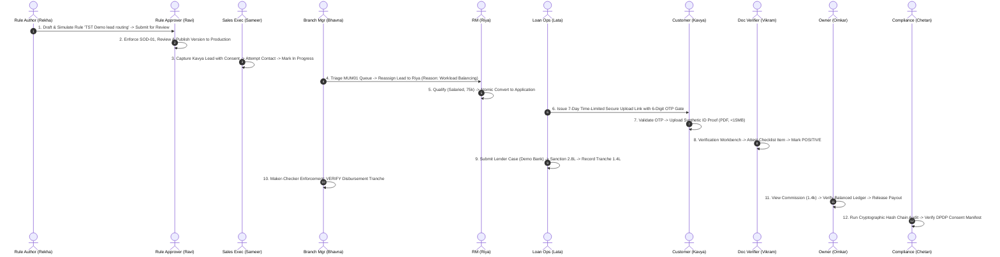

# DSA CRM — Comprehensive Project End-to-End (E2E) Test Cases & Demo Execution Manual

> **Document Version:** 2.0 (Release `v0.1.0-rc.1` / `beta` Synchronized)  
> **Source Baseline:** [DSA CRM Manual Testing Notion Master Suite](https://app.notion.com/p/DSA-CRM-Manual-Testing-40536c094b4b80e9a874c7efd9a6a14d?source=copy_link), Playwright Automated Suite (`e2e/*.spec.ts`), contracts in `@dsa/contracts`, and UI routes in `apps/web/src/shell/access.ts`.  
> **Target Audience:** QA Engineers, Product Managers, Implementation Leads, Demo Presenters, and Security Auditors.  
> **Data Protection Rule:** Synthetic data only. Never input real PAN, Aadhaar, bank account numbers, or personal mobile numbers. All test datasets use regulatory-compliant synthetic representations.

---

## 1. Executive Summary & Architecture Blueprint

The **DSA CRM (Distributed Sourcing Agent Customer Relationship Management Platform)** is a high-assurance, multi-tenant loan origination and distribution management system built specifically for Non-Banking Financial Companies (NBFCs) and lending institutions.

The platform orchestrates the complete loan lifecycle from multi-channel lead ingestion, consent governance, automated Business Rules Engine (BRE) routing, and qualification to atomic customer/application conversion, verification workbench reviews, multi-lender package submissions, sanction recording, disbursement tranche maker-checker approvals, double-entry commission settlement, and immutable cryptographic audit logging.

```mermaid
flowchart TD
    subgraph S1["1. Governance & Rule Authorship"]
        RA["Rule Author: Rekha<br/>(Draft & Simulate)"] -->|Submit| RAP["Rule Approver: Ravi<br/>(Review, Approve, Publish)"]
    end

    subgraph S2["2. Sales & Intake"]
        RAP -->|Active Rules| SE["Sales Executive: Sameer<br/>(Lead Capture + Consent)"]
        SE -->|Attempt Contact| BM["Branch Manager: Bhavna<br/>(Triage & Reassign)"]
    end

    subgraph S3["3. Sourcing & Qualification"]
        BM -->|Assigned| RM["Relationship Manager: Riya<br/>(Qualify & Convert)"]
        RM -->|Atomic Convert| APP["Loan Application<br/>Created"]
    end

    subgraph S4["4. Document Collection & Verification"]
        APP --> LO["Loan Operations: Lata<br/>(Gen 2FA Upload Link)"]
        LO --> CUST["Customer: Kavya<br/>(6-Digit OTP + Upload)"]
        CUST --> DV["Document Verifier: Vikram<br/>(Attest & Verdict)"]
    end

    subgraph S5["5. Lender Processing & Disbursement"]
        DV --> LC["Loan Ops: Lata<br/>(Submit Lender Case)"]
        LC --> SNC["Loan Ops: Lata<br/>(Sanction & Tranche Entry)"]
        SNC --> VRF["Branch Mgr / Owner<br/>(Verify Tranche Maker-Checker)"]
    end

    subgraph S6["6. Finance, Commission & Settlement"]
        VRF --> FIN["Finance / Owner: Omkar<br/>(Commission Statement)"]
        FIN --> LED["Double-Entry Ledger<br/>(Balanced Postings)"]
        LED --> PAY["Dual-Control Payout<br/>(Maker Prep -> Checker Release)"]
    end

    subgraph S7["7. Compliance & Cryptographic Audit"]
        PAY --> CO["Compliance Officer: Chetan<br/>(Hash Chain Verify & DPDP Audit)"]
    end
```



---

## 2. Test Environment, Seed Configuration & Demo Accounts

### 2.1 Runtime Environment
| Environment Component | URL / Port | Startup Script / Command |
|---|---|---|
| **Web Application (Vite + React 18)** | `http://localhost:5173` | `npm run dev -w @dsa/web` |
| **Modular Monolith API (Express 5)** | `http://localhost:3000` | `npm run dev -w @dsa/api` |
| **Local Database (PostgreSQL 16 / Supabase)** | `localhost:54322` | `npm run db:start && npm run db:reset` |
| **E2E Playwright Suite (Mocked)** | Headless / Headed | `npm run test:e2e` or `npx playwright test --headed` |
| **Live Playwright Flow** | Headed real API | `npx playwright test -c playwright.live.config.ts --headed` |

### 2.2 Master Demo Accounts Directory (`vaibhav-finserv` & `demo-alpha`)

#### A. Platform Super Admin (System Operator Realm)
- **Account Email:** `vaibhav.qloax@gmail.com`
- **Password:** `Vaibhav@1234`
- **Role Assignment:** `ROLE-PLATFORM-SUPERADMIN` (Platform Tenant `ten_01M4ZG67WTS51Q0XN7F1Y9CCYG`)
- **Scope:** Global platform console, all tenants, feature flags, system orchestration.

#### B. Active Organization: `vaibhav-finserv` (Vaibhav Finserv Private Limited)
- **Tenant ID:** `ten_01M5V9DW51908MVT3D6P4M7NDA`
- **Standard Password (All Roles):** `Vaibhav@1234`
- **Branches:** `MUM01` (Mumbai Central - 400008), `PUN01` (Pune Camp - 411001)

| # | Role Persona | Full Name | Active Login Email | Password | Primary Branch | Data Scope Boundary | Mandatory MFA |
|---|---|---|---|---|---|---|---|
| **01** | **Platform Super Admin** | Vaibhav Superadmin | `vaibhav.qloax@gmail.com` | `Vaibhav@1234` | Platform Realm | Global platform (tenants, flags, master data) | Required |
| **02** | **Tenant Admin** | Vaibhav Admin | `vaibhav+admin@qloax.com` | `Vaibhav@1234` | `MUM01` | Entire Tenant (`vaibhav-finserv`) organization | Required |
| **03** | **Organisation Owner** | Vaibhav Owner | `vaibhav+owner@qloax.com` | `Vaibhav@1234` | `MUM01` | Entire Tenant portfolio, pipeline, finance, dual-control | Required |
| **04** | **Branch Manager** | Vaibhav Branch Mgr | `vaibhav+branchmgr@qloax.com`| `Vaibhav@1234` | `MUM01` | `MUM01` Mumbai Central records exclusively | Discretionary |
| **05** | **Team Manager** | Vaibhav Team Mgr | `vaibhav+teammgr@qloax.com` | `Vaibhav@1234` | `MUM01` | "MUM01 Sales Team" members (RM1, RM2, Sales) | Discretionary |
| **06A**| **Relationship Manager 1**| Vaibhav RM 1 | `vaibhav+rm1@qloax.com` | `Vaibhav@1234` | `MUM01` | Personally assigned leads & applications (Mumbai) | Standard |
| **06B**| **Relationship Manager 2**| Vaibhav RM 2 | `vaibhav+rm2@qloax.com` | `Vaibhav@1234` | `MUM01` | Personally assigned leads & applications (Mumbai) | Standard |
| **06C**| **Relationship Manager (Pune)**| Vaibhav RM Pune | `vaibhav+rmpune@qloax.com` | `Vaibhav@1234` | `PUN01` | Personally assigned leads & applications (Pune) | Standard |
| **07** | **Sales Executive** | Vaibhav Sales | `vaibhav+sales@qloax.com` | `Vaibhav@1234` | `MUM01` | Personally created/assigned intake leads only | Standard |
| **08** | **Loan Operations** | Vaibhav Loan Ops | `vaibhav+loanops@qloax.com` | `Vaibhav@1234` | `MUM01` + `PUN01`| Multi-branch loan files, lender cases, disbursements | Required |
| **09** | **Document Verifier** | Vaibhav Verifier | `vaibhav+verifier@qloax.com`| `Vaibhav@1234` | `MUM01` | Verification queue & checklist attestation | Standard |
| **10** | **Compliance Officer** | Vaibhav Compliance | `vaibhav+compliance@qloax.com`| `Vaibhav@1234` | `MUM01` | Read-only tenant audit, privacy, incident logs | Required |
| **11** | **Rule Author** | Vaibhav Rule Author | `vaibhav+ruleauthor@qloax.com`| `Vaibhav@1234` | `MUM01` | BRE Rule Sets draft, authoring & simulation | Required |
| **12** | **Rule Approver** | Vaibhav Rule Approver| `vaibhav+ruleapprover@qloax.com`| `Vaibhav@1234`| `MUM01` | BRE Rule Sets approval, publishing & suspension | Required |
| **13A**| **Finance Executive** | Vaibhav Finance | `vaibhav+finance@qloax.com` | `Vaibhav@1234` | `MUM01` | Commission calculation, invoice & payout preparation | Required |
| **13B**| **Commission Approver**| Vaibhav Commission | `vaibhav+commission@qloax.com`| `Vaibhav@1234`| `MUM01` | Dual-control payout approval & UTR recording | Required |
| **14** | **Customer (External)** | Kavya Deshmukh | External Borrower Link | 6-Digit OTP | N/A | Public one-time token upload link with 2FA OTP gate | 6-Digit OTP |

> **Note on Legacy Synthetic Demo Seed (`demo-alpha`):**  
> For legacy scripts configured with `@alpha.com` (`admin@alpha.com`, `owner@alpha.com`, `rm1@alpha.com`, etc.), those accounts remain active in tenant `demo-alpha` as a secondary testing baseline.

---

## 3. Shared Demo Dataset Specification

To ensure end-to-end traceability across all 14 personas, the test suite utilizes pre-defined, standardized synthetic entities.

### 3.1 Standard Leads Register
| Lead Identifier | Applicant Name | Mobile (Masked in UI) | Email Address | Pincode | Branch | Product Category | Indicative Amount | Ingestion Channel | Purpose in Test Suite |
|---|---|---|---|---|---|---|---|---|---|
| **Lead A** | **Kavya Deshmukh** | `9876501234` (`••••••1234`) | `kavya.deshmukh@example.com` | `400008` | `MUM01` | Personal Loan (`PL`) | ₹3,00,000 | Walk-in ("Branch booth") | **Primary Golden Path Lifecycle Candidate** |
| **Lead B** | Kavya D | `9876501234` (`••••••1234`) | `kavya.d@example.com` | `400008` | `MUM01` | Personal Loan (`PL`) | ₹2,50,000 | Phone Inbound | **Duplicate Detection Test (Same Mobile)** |
| **Lead C** | (Blank) | `12345` | `not-an-email` | `01234` | `MUM01` | Personal Loan (`PL`) | -₹50,000 | Phone Inbound | **Form Validation & Negative Edge Cases** |
| **Lead D** | Arjun Mehta | `9876509876` (`••••••9876`) | `arjun.mehta@example.com` | `411001` | `PUN01` | Business Loan (`BL`) | ₹12,00,000 | Referral Connector | **Cross-Branch Data Isolation (Pune Branch)** |
| **Lead E** | Neha Iyer | `9876511111` (`••••••1111`) | `neha.iyer@example.com` | `400008` | `MUM01` | Home Loan (`HL`) | ₹45,00,000 | Digital Web Ingestion | **Batch CSV Import & Disqualification Flow** |

### 3.2 Lead A Downstream Financial Terms
- **Applicant Profile:** Salaried, Monthly Income: ₹75,000, Employer: Standard Corp.
- **Approved Lender:** `Demo Bank` (Type: Commercial Scheduled Bank).
- **Lender Submission Channel:** Lender Partner Portal (`DEMO-REF-0001`).
- **Sanction Terms:** Approved Amount: ₹2,80,000, Interest Rate: 11.5% p.a. (Fixed), Tenure: 36 Months.
- **Disbursement Tranche #1:** Amount: ₹1,40,000, Loan Account No: `LA000000123`, UTR Reference: `UTR0000000001`.
- **Commission Calculation:** Base Rate: 1.00% on Disbursed Tranche = ₹1,400.00 Gross Receivable.

---

## 4. Master 12-Step End-to-End "Golden Path" Lifecycle Demo

This unbroken narrative demonstrates the real-world operational journey of **Lead A (Kavya Deshmukh)** traversing every role in strict sequence.



### Detailed Golden Path Execution Protocol

| Step | Persona | Screen / URL | Exact Action & Input Data | Expected Verification Result |
|---|---|---|---|---|
| **01** | **Tenant Admin** | `/admin/branches` & `/users` | Verify branch `MUM01` exists; verify active status of `sales1`, `rm1`, `branchmgr`, `loanops`. | Environment confirmed ready for lifecycle test. |
| **02** | **Rule Author → Approver** | `/rules` | **Rekha:** Create rule set `TST Demo lead routing`, simulate with (PL, ₹3,00,000, 400008), submit. **Ravi:** Review, approve, publish to production. | Version status shows `ACTIVE`. Approver differs from author (`SOD-01` verified). |
| **03** | **Sales Executive** | `/leads/new` | Fill Kavya Deshmukh, `9876501234`, `kavya.deshmukh@example.com`, `400008`, PL, ₹3,00,000. Consent: Loan Processing + Contact, In Person, `v1.0`. Click **Attempt Contact** → **Mark In Progress**. | Lead state moves from `NEW` → `CONTACT_ATTEMPTED` → `IN_PROGRESS`. Activity logged. |
| **04** | **Branch Manager** | `/leads` → Detail | Open Kavya's lead. Click **Assign**. Target: `Riya RM (rm1@alpha.com)`, Reason: `Workload Balancing`. | Assigned owner updates to Riya. Audit captures reassignment with rationale. |
| **05** | **Relationship Manager** | `/leads` → Detail | Open assigned lead. Click **Qualify Lead** (Salaried, Income: ₹75,000, Requested: ₹3,00,000). Click **Convert to Loan Application**. | Lead state: `CONVERTED`. Application `app_kavya_001` created atomically. |
| **06** | **Loan Operations** | `/document-sharing` | Click **New Customer Upload Link**. Select Kavya's application, ID-proof checklist item, expiry: 7 days. Copy secure token URL. | One-time secure URL generated. Link status: `ACTIVE`. |
| **07** | **Public Customer** | `/upload/<token>` (Incognito) | Open link in private window. Enter 6-digit OTP sent to masked contact. Upload `kavya-id-proof.pdf` (Synthetic PDF, 120 KB). | Upload banner shows success. Portal state: `1 of 1 Uploaded`. |
| **08** | **Document Verifier** | `/verifications/workbench` | Select Kavya's ID document. Tick **Attest Checklist Document**. Select Verdict: `Positive`. Click **Complete Verification Assessment**. | Document status transitions to `VERIFIED`. Verifier identity and timestamp attested. |
| **09** | **Loan Operations** | `/lender-cases` & `/sanctions` | 1. Create Lender Attempt: Lender `Demo Bank`, Ref `DEMO-REF-0001`.<br/>2. Transition status: `SANCTIONED` (₹2,80,000, 11.5%, 36 mos).<br/>3. Record Tranche #1: ₹1,40,000, Account `LA000000123`, UTR `UTR0000000001`. | Sanction recorded. Tranche logged with status `PENDING_VERIFICATION`. |
| **10** | **Branch Manager / Owner** | `/sanctions/<caseId>` | Log in as Bhavna Branch (or Omkar Owner). Open Tranche #1. Click **VERIFY Tranche**. (Lata is blocked from verifying own entry). | Tranche status: `VERIFIED`. Dual-control maker-checker enforced (`SOD-04`). |
| **11** | **Organisation Owner** | `/commission` & `/payouts` | 1. `/commission`: Verify 1% statement generated (₹1,400.00).<br/>2. `/ledger`: Confirm balanced journal entry (Debit: Bank Receivable, Credit: Income).<br/>3. `/payouts`: Prepare payout batch and approve. | Commission recognized. Ledger balances to zero difference. Payout approved. |
| **12** | **Compliance Officer** | `/audit` & `/privacy` | 1. `/audit`: Click **Verify Chain Integrity**.<br/>2. `/privacy`: Inspect Kavya's active consent & open **Data Sharing Manifest** for Demo Bank. | Cryptographic hash chain passes with zero tampering. Manifest shows exact sharing metadata. |

---

## 5. Detailed Role Profiles, Functional Specifications & Test Cases

---

### Persona 01: Platform Super Admin (`ROLE-PLATFORM-SUPER-ADMIN`)

#### 1. Persona Profile & Access Boundary
- **Login:** Platform Operator (`platform.admin@qloax.com`)
- **Realm:** Platform Operator Realm (External to customer tenant workspaces)
- **Data Scope:** Global tenants directory, feature flag management, background system jobs, release orchestration, and tenant support access requests.
- **Allowed Sidebar Routes:** Home (`/`), Platform Console (`/platform-admin`), Account Security (`/account/security`).
- **Forbidden Routes (403):** `/leads`, `/applications`, `/lender-cases`, `/customers`, `/commission`, `/audit`, `/rules`. Must never see borrower PII.

#### 2. Screen-by-Screen E2E Test Cases / Demo Scripts

##### TC-PSA-01: Tenant Directory Management & Organization Provisioning
- **Screen:** `/platform-admin` (Tab: Tenants Directory)
- **Objective:** Verify multi-tenant isolation, directory listing, and new tenant onboarding.
- **Demo Script & Steps:**
  1. Navigate to `/platform-admin`.
  2. Verify directory displays active tenant entities (`demo-alpha`, `test-finserv`).
  3. Click `+ Onboard Tenant`. Enter Tenant Name: `Beta Capital NBFC`, Tenant Identifier: `beta-cap`, Org Tier: `ENTERPRISE`.
  4. Submit form and verify tenant appears in active state with 0 customer records.
- **Expected Result:** Tenant entity created with isolated schema/tenant ID. Customer data remains completely isolated.
- **Why You Do This:** Real-world NBFC SaaS platforms host multiple competing financial entities. Multi-tenancy must be strictly bounded at the data layer so Tenant A can never leak records to Tenant B.

##### TC-PSA-02: Tenant Feature Flags Orchestration & Circuit Breakers
- **Screen:** `/platform-admin` (Tab: Feature Flags)
- **Objective:** Dynamically toggle experimental capabilities (e.g. Eligibility Engine, Supabase Document Storage) per tenant.
- **Demo Script & Steps:**
  1. Select tenant `demo-alpha`.
  2. Locate feature flag `FLAG_ELIGIBILITY_ENGINE`. Toggle from `ENABLED` to `DISABLED`.
  3. Sign in as `admin@alpha.com` in parallel window: confirm `/eligibility` is removed from navigation.
  4. Toggle flag back to `ENABLED` and confirm restoration.
- **Expected Result:** Feature flags take effect immediately without requiring application redeployment.
- **Why You Do This:** Allows controlled beta rollouts, emergency feature disabling during outages, and tier-based feature gating.

##### TC-PSA-03: Timed Support Access Request & Boundary Enforcement
- **Screen:** `/platform-admin` (Tab: Support Access)
- **Objective:** Verify platform support cannot access tenant data without formal tenant admin authorization.
- **Demo Script & Steps:**
  1. Click **Request Support Session** for `demo-alpha`.
  2. Set duration: `60 Minutes`, Purpose: `Escalated Ticket #4092 - BRE Simulation Issue`.
  3. Attempt to view `/leads`: observe hard rejection `403 FORBIDDEN - Support Session Not Authorized`.
  4. Log in as Asha Admin (`admin@alpha.com`), navigate to `/approvals`, and approve support request.
  5. Return to Platform Admin: verify read-only access granted for exactly 60 minutes with full audit logging.
- **Expected Result:** Zero backdoors. Support access requires explicit tenant dual-control approval.
- **Why You Do This:** Compliance with RBI Digital Lending Guidelines and ISO 27001 requires customer consent for third-party support access.

---

### Persona 02: Tenant Admin (`ROLE-TENANT-ADMIN`)

#### 1. Persona Profile & Access Boundary
- **Login:** Asha Admin (`admin@alpha.com`)
- **Data Scope:** Full organization governance across all branches, queues, users, roles, and system configuration.
- **Allowed Sidebar Routes:** Workspace (`/`, `/tasks`, `/activity`, `/messaging`, `/notifications`, `/grievances`), Sales & CRM (`/leads`, `/customers`), Loan Origination (`/applications`, `/eligibility`, `/lender-cases`, `/sanctions`, `/documents`, `/document-sharing`, `/verifications`), Partners & Operations (`/workforce`, `/connectors`, `/connector-portal`), Analytics & Performance (`/performance`, `/targets`, `/leaderboard`, `/reports`), Governance & Administration (`/admin/organisation`, `/admin/branches`, `/admin/teams`, `/admin/queues`, `/users`, `/roles`, `/config`, `/admin/import-export`, `/audit`, `/privacy`, `/approvals`, `/incidents`, `/security`).
- **Forbidden Routes (403):** Platform Console (`/platform-admin`), BRE Rule Sets editing (`/rules`), Finance execution (`/payouts`, `/ledger`, `/reconciliation`).

#### 2. Screen-by-Screen E2E Test Cases / Demo Scripts

##### TC-TA-01: Branch & Operational Queue Provisioning
- **Screen:** `/admin/branches` & `/admin/queues`
- **Objective:** Create a new branch office and establish automated intake work queues.
- **Demo Script & Steps:**
  1. Navigate to `/admin/branches`, click **Create Branch**.
  2. Enter Branch Code: `NAS01`, Name: `Nashik Demo`, Pincode: `422001`. Save.
  3. Attempt to create another branch with identical code `NAS01`: verify rejection `Branch code already registered`.
  4. Navigate to `/admin/queues`, click **New Queue**. Name: `NAS01-INTAKE`, Routing Type: `ROUND_ROBIN`, Branch: `NAS01`.
- **Expected Result:** Branch `NAS01` registered. Unique constraints enforced. Work queue operational.
- **Why You Do This:** Branch codes form the core data partition boundary. Duplicate branches would cause lead misrouting and reporting distortion.

##### TC-TA-02: Staff User Onboarding & Mobile E.164 Strict Validation
- **Screen:** `/users` → **Create User**
- **Objective:** Provision a new staff member with branch assignment and validate phone number standards.
- **Demo Script & Steps:**
  1. Click **Create User**.
  2. Input Name: `TST Trainee`, Email: `tst.trainee@example.com`, Mobile: `9876522222` (without country code).
  3. Click Save: observe validation error `Mobile number must follow E.164 format (+91XXXXXXXXXX)`.
  4. Correct mobile to `+919876522222`, Branch: `MUM01`, Role: `Sales Executive`. Submit.
  5. Attempt to create another user with the same email: verify unique constraint rejection.
- **Expected Result:** User provisioned in `INVITED` state. E.164 standard enforced.
- **Why You Do This:** Standardized phone numbers are critical for SMS OTP delivery and duplicate phone number hashing algorithms.

##### TC-TA-03: Custom Role Creation & Privilege Escalation Guard
- **Screen:** `/roles` → **Create Custom Role**
- **Objective:** Create granular role permissions while verifying the system blocks privilege escalation.
- **Demo Script & Steps:**
  1. Click **Create Custom Role**. Name: `Credit Analyst`, Code: `ROLE-CREDIT-ANALYST`.
  2. Select permissions: `leads:read`, `applications:read`, `documents:read`. Save successfully.
  3. Edit role and attempt to grant `platform:admin` or `system:bypass_rls`: observe permission disabled or rejected with `403 CANNOT_GRANT_UNHELD_PRIVILEGE`.
  4. Delete the custom role: confirm deletion succeeds. Attempt to delete built-in `ROLE-RM`: confirm system blocks deletion.
- **Expected Result:** Custom roles are strictly bounded by the creator's granted privileges. Built-in system roles are protected.
- **Why You Do This:** Prevents rogue administrators from elevating their own accounts into superuser or financial execution roles.

##### TC-TA-04: Batch Lead CSV Ingestion with Synthetic Row Validation
- **Screen:** `/admin/import-export`
- **Objective:** Test bulk lead ingestion, header validation, and inline syntax error checking.
- **Demo Script & Steps:**
  1. Download the official CSV template from `/admin/import-export`.
  2. Upload valid CSV containing Lead E (`Neha Iyer`, `9876511111`, `HL`, `4500000`, `400008`).
  3. Verify staging preview shows 1 valid row with green checkmarks.
  4. Upload second CSV containing malformed row (`Lead C`: negative amount, invalid mobile `12345`): verify preview flags row in red with exact error tooltips.
- **Expected Result:** Bad data is trapped in staging before touching production database tables.
- **Why You Do This:** Marketing campaigns frequently upload thousands of leads. Parsing errors must be quarantined before batch ingestion.

---

### Persona 03: Organisation Owner (`ROLE-ORGANISATION-OWNER`)

#### 1. Persona Profile & Access Boundary
- **Login:** Omkar Owner (`owner@alpha.com`)
- **Data Scope:** Full executive visibility across all branches, financial ledgers, commission statements, and audit trails.
- **Allowed Sidebar Routes:** All workspace, sales, loan origination, analytics, performance, and finance screens (`/commission`, `/payouts`, `/ledger`, `/invoices`, `/reconciliation`, `/performance`, `/targets`, `/reports`, `/audit`).
- **Forbidden Routes (403):** Platform Console (`/platform-admin`), BRE Rule Sets authoring (`/rules`).

#### 2. Screen-by-Screen E2E Test Cases / Demo Scripts

##### TC-OWN-01: Executive Portfolio Analytics & Sourcing Funnel
- **Screen:** `/reports` & `/performance`
- **Objective:** Evaluate business pipeline health, conversion rates, and branch velocity.
- **Demo Script & Steps:**
  1. Open `/reports` (Reports & Catalogue).
  2. Apply Date Range filter: `This Month`.
  3. Verify Pipeline Funnel stages: `Leads Captured (5)` → `Qualified (3)` → `Applications (2)` → `Sanctioned (1)` → `Disbursed (1)`.
  4. Switch view to `/performance/leaderboard`: observe Mumbai branch vs. Pune branch conversion ratios.
- **Expected Result:** Dynamic aggregation across both branches without data latency.
- **Why You Do This:** Executive leadership relies on accurate portfolio velocity to allocate lending capital and branch resources.

##### TC-OWN-02: Target Setting & Sourcing Quota Allocation
- **Screen:** `/targets`
- **Objective:** Configure monthly conversion quotas for teams and relationship managers.
- **Demo Script & Steps:**
  1. Open `/targets`, click **Set Target**.
  2. Assign Target: User: `Riya RM (rm1@alpha.com)`, Metric: `Conversion Count`, Target Value: `5`, Period: `Current Month`.
  3. Save target. Log in as Riya RM: confirm target card reflects `1 of 5 Achieved (20%)`.
- **Expected Result:** Quota changes propagate immediately to the RM dashboard.
- **Why You Do This:** Drives sales performance tracking against NBFC disbursement goals.

##### TC-OWN-03: Dual-Control Payout Release & Financial Maker-Checker
- **Screen:** `/payouts`
- **Objective:** Ensure dual-control financial authorization on partner referral payouts.
- **Demo Script & Steps:**
  1. Navigate to `/payouts`.
  2. Locate payout batch prepared by Finance Executive (Batch #`PAY-2026-10-001`, Amount: `₹1,400.00`).
  3. Inspect payout breakdown, tax deduction (TDS), and partner bank details.
  4. Click **Approve & Authorize Payout**. Enter MFA OTP.
  5. Verify batch status transitions to `APPROVED_FOR_DISBURSEMENT`.
- **Expected Result:** Payout authorized. Owner cannot approve batches they created personally (`SOD-03`).
- **Why You Do This:** Prevents unauthorized embezzlement by enforcing that financial releases require two separate authenticated pairs of eyes.

---

### Persona 04: Branch Manager (`ROLE-BRANCH-MANAGER`)

#### 1. Persona Profile & Access Boundary
- **Login:** Bhavna Branch (`branchmgr@alpha.com`)
- **Data Scope:** Strictly limited to `MUM01` (Mumbai Central) branch records.
- **Allowed Sidebar Routes:** `/leads`, `/customers`, `/tasks`, `/activity`, `/messaging`, `/applications`, `/lender-cases`, `/sanctions`, `/documents`, `/document-sharing`, `/verifications`, `/connectors`, `/privacy`, `/approvals`.
- **Forbidden Routes (403):** `/platform-admin`, `/admin/organisation`, `/roles`, `/commission`, `/payouts`, `/ledger`, `/rules`.
- **Negative Boundary:** Cannot query or access Pune (`PUN01`) leads or applications.

#### 2. Screen-by-Screen E2E Test Cases / Demo Scripts

##### TC-BM-01: Branch Pipeline Triage & Geographic Isolation Check
- **Screen:** `/leads`
- **Objective:** Verify branch manager sees Mumbai records while Pune records are completely masked.
- **Demo Script & Steps:**
  1. Log in as `branchmgr@alpha.com`. Open `/leads`.
  2. Confirm Lead A (`Kavya Deshmukh`, MUM01) is visible.
  3. Search for Lead D (`Arjun Mehta`, PUN01): verify result returns `0 records found`.
  4. Attempt direct URL navigation to `/leads/led_arjun_pune_004`: verify system returns `404 NOT FOUND` or `403 FORBIDDEN`.
- **Expected Result:** Strict row-level security (RLS) enforcement based on staff branch assignment.
- **Why You Do This:** In retail financial sourcing, cross-branch data poaching creates internal conflict and violates customer branch jurisdiction.

##### TC-BM-02: Lead Reassignment with Mandatory Audit Reason Code
- **Screen:** `/leads/<leadId>` → **Assign**
- **Objective:** Reassign lead between branch staff members with mandatory justification.
- **Demo Script & Steps:**
  1. Open Kavya Deshmukh's lead.
  2. Click **Assign Lead**.
  3. In Assignee dropdown, verify only `MUM01` staff are listed (Sameer, Riya, Rohan). Pune staff are absent.
  4. Select Target: `Riya RM`. Reason Code: leave blank. Click Submit: observe validation error `Select a valid reassignment reason code`.
  5. Select Reason: `Workload Balancing`. Submit.
  6. Verify lead owner updates to Riya RM. Open `/activity`: confirm event logged with timestamp, previous owner, new owner, and reason.
- **Expected Result:** Lead reassigned. Audit trail preserves regulatory proof of lead ownership changes.
- **Why You Do This:** Fair distribution of business leads prevents favoritism and ensures SLA adherence.

##### TC-BM-03: Disbursement Tranche Verification (Maker-Checker Oversight)
- **Screen:** `/sanctions/<caseId>`
- **Objective:** Execute secondary verification on disbursement tranches entered by Loan Operations.
- **Demo Script & Steps:**
  1. Open Sanctions tab for Kavya's loan case.
  2. Locate Tranche #1 (Amount: `₹1,40,000`, UTR: `UTR0000000001`).
  3. Status shows `PENDING_VERIFICATION` recorded by `loanops@alpha.com`.
  4. Click **VERIFY Tranche**. Confirm dialog.
  5. Verify status updates to `VERIFIED`. Tranche is now eligible for commission settlement.
- **Expected Result:** Tranche locked in verified status. Maker (Lata) was barred from verifying her own entry.
- **Why You Do This:** Regulatory mandate: disbursement data drives accounting. Dual verification prevents erroneous bank references and phantom payouts.

---

### Persona 05: Team Manager (`ROLE-TEAM-MANAGER`)

#### 1. Persona Profile & Access Boundary
- **Login:** Tarun Team (`teammgr@alpha.com`)
- **Data Scope:** Team "MUM01 Sales" members only (Riya RM, Rohan RM, Sameer Sales).
- **Allowed Sidebar Routes:** `/leads`, `/customers`, `/tasks`, `/activity`, `/messaging`, `/applications`, `/eligibility`, `/lender-cases`, `/documents`, `/workforce`, `/privacy`.
- **Forbidden Routes (403):** `/verifications/workbench`, `/commission`, `/payouts`, `/ledger`, `/audit`, `/rules`, `/admin/*`.

#### 2. Screen-by-Screen E2E Test Cases / Demo Scripts

##### TC-TM-01: Team Lead Balancing & Internal Reassignment
- **Screen:** `/leads`
- **Objective:** Monitor sales team queue and redistribute workloads.
- **Demo Script & Steps:**
  1. Open `/leads`. Filter by `Team: MUM01 Sales`.
  2. Identify Sameer Sales has 8 active leads while Riya has 2.
  3. Select lead, click **Reassign**. Select Assignee: `Riya RM`, Reason: `Workload Balancing`.
  4. Attempt to reassign lead to a user in another branch: confirm user is not available in dropdown.
- **Expected Result:** Workload rebalanced across team members within permitted hierarchy.
- **Why You Do This:** Prevents lead aging and SLA breaches when individual sales reps are overwhelmed.

##### TC-TM-02: Workforce Capacity & Real-Time Availability Roster
- **Screen:** `/workforce`
- **Objective:** Manage operational availability of sales reps to control automated BRE lead routing.
- **Demo Script & Steps:**
  1. Navigate to `/workforce`.
  2. Locate `Rohan RM`. Current Availability: `AVAILABLE`.
  3. Toggle availability switch to `ON_LEAVE` / `UNAVAILABLE`.
  4. Verify system displays confirmation toast: `User availability updated. Routing engine will bypass this user.`
  5. Toggle back to `AVAILABLE`.
- **Expected Result:** Automated routing rules skip unavailable personnel without failing the assignment queue.
- **Why You Do This:** High-velocity lead desks cannot afford leads being assigned to staff on emergency leave.

##### TC-TM-03: Team Task & SLA Supervision
- **Screen:** `/tasks`
- **Objective:** Delegate critical customer follow-ups and monitor task completion.
- **Demo Script & Steps:**
  1. Open `/tasks`, click **Create Task**.
  2. Title: `Urgent Salary Slip Follow-Up`, Due Date: `Today + 1 Day`, Linked Lead: `Kavya Deshmukh`, Assignee: `Riya RM`.
  3. Save task. Switch to Riya RM login: verify task appears with high priority banner on her dashboard.
- **Expected Result:** Actionable follow-up assigned and tracked through completion.
- **Why You Do This:** Enforces accountability on hot leads to maximize customer conversion rates.

---

### Persona 06: Relationship Manager (`ROLE-RELATIONSHIP-MANAGER`)

#### 1. Persona Profile & Access Boundary
- **Login:** Riya RM (`rm1@alpha.com`)
- **Data Scope:** Strictly limited to personally assigned leads, customers, and applications.
- **Allowed Sidebar Routes:** `/leads`, `/customers`, `/tasks`, `/activity`, `/messaging`, `/applications`, `/eligibility`, `/lender-cases`, `/documents`, `/verifications`, `/privacy`, `/security`.
- **Forbidden Routes (403):** `/commission`, `/payouts`, `/ledger`, `/invoices`, `/rules`, `/audit`, `/admin/*`. Cannot see Rohan RM's records.

#### 2. Screen-by-Screen E2E Test Cases / Demo Scripts

##### TC-RM-01: Proactive Lead Intake Validation & Phone Validation
- **Screen:** `/leads/new`
- **Objective:** Capture direct customer intake while testing client-side validation barriers.
- **Demo Script & Steps:**
  1. Open `/leads/new`.
  2. Submit completely blank form: verify required validation banners for `Full Name`, `Mobile`, `Amount`.
  3. Test invalid mobile numbers:
     - `12345` → Error: `Enter a 10-digit mobile number starting with 6, 7, 8 or 9`.
     - `5876501234` (starts with 5) → Error: `Enter a 10-digit mobile number starting with 6, 7, 8 or 9`.
  4. Test invalid email `alpha.qa`: verify format error.
  5. Test invalid pincode `012345`: verify error `Pincode cannot start with 0`.
  6. Fill valid details: Full Name: `Test Customer Alpha`, Mobile: `9000000101`, Email: `alpha.qa@example.com`, Pincode: `411001`, Amount: `₹3,00,000`, Product: `Personal Loan`.
  7. Submit. Verify redirect to `/leads/<id>` in state `NEW`.
- **Expected Result:** Strict input sanitation stops bad records before API submission.
- **Why You Do This:** Invalid borrower contact information completely wastes outbound calling efforts.

##### TC-RM-02: Real-Time Mobile Duplicate Detection & Banner Surfacing
- **Screen:** `/leads/new`
- **Objective:** Verify system detects existing mobile numbers and flags duplicate leads.
- **Demo Script & Steps:**
  1. Click **Create New Lead**.
  2. Enter Name: `Kavya D`, Mobile: `9876501234` (identical to Lead A), Amount: `₹2,50,000`.
  3. Submit lead.
  4. Open newly created lead detail: observe high-visibility yellow alert banner: `DUPLICATE DETECTED: Mobile matches existing Lead #LED-001 (Kavya Deshmukh)`.
  5. Verify Duplicate Flag is set to `POTENTIAL_DUPLICATE`.
- **Expected Result:** Lead is ingested but clearly marked, preventing duplicate commission or disjointed communication.
- **Why You Do This:** Multiple sourcing agents frequently enter the same borrower. De-duplication prevents customer harassment and commission fraud.

##### TC-RM-03: Multi-Purpose DPDP Consent Recording & Verification
- **Screen:** `/leads/new` & `/privacy`
- **Objective:** Enforce explicit consent collection under Digital Personal Data Protection (DPDP) Act standards.
- **Demo Script & Steps:**
  1. In lead creation form, attempt to submit without selecting consent purposes: verify blocked with `Consent is mandatory`.
  2. Select Purposes: `Loan Processing`, `Contact Communication`.
  3. Channel: `In Person`, Notice Version: `v1.0`. Submit.
  4. Navigate to `/privacy`, search applicant: confirm active consent record displayed with timestamp and IP/operator hash.
- **Expected Result:** Consent captured as an immutable legal artifact before customer engagement.
- **Why You Do This:** Regulatory mandate: Indian DPDP Act mandates explicit, purpose-limited consent prior to processing financial data.

##### TC-RM-04: Customer Qualification & Financial Viability Assessment
- **Screen:** `/leads/<id>` → **Qualify Lead**
- **Objective:** Evaluate applicant income against loan ticket size.
- **Demo Script & Steps:**
  1. Open Lead A (state: `IN_PROGRESS`).
  2. Click **Qualify Lead**.
  3. Attempt submit with monthly income: `₹0` or blank: verify rejected.
  4. Enter Applicant Type: `Salaried`, Monthly Net Income: `₹75,000`, Requested Amount: `₹3,00,000`.
  5. Click **Confirm Qualification**.
  6. Verify lead state transitions to `QUALIFIED`. Button **Convert to Loan Application** becomes enabled.
- **Expected Result:** Lead marked qualified. Eligibility criteria recorded.
- **Why You Do This:** Sifting non-viable applicants early preserves back-office underwriting capacity.

##### TC-RM-05: Atomic Conversion from Lead to Customer & Loan Application
- **Screen:** `/leads/<id>` → **Convert**
- **Objective:** Perform transactional conversion of lead into customer entity and loan application.
- **Demo Script & Steps:**
  1. On qualified lead, click **Convert to Loan Application**.
  2. System prompts for conversion confirmation. Confirm.
  3. Verify lead state moves to `CONVERTED`.
  4. Verify application created with matching parameters (Product: `PL`, Amount: `₹3,00,000`).
  5. Click conversion button again: confirm action is permanently disabled.
- **Expected Result:** Single database transaction creates Customer record, Application record, and locks Lead record.
- **Why You Do This:** Prevents duplicate application generation and maintains strict entity lineage.

##### TC-RM-06: Read & Assessment Eligibility Engine Execution
- **Screen:** `/eligibility`
- **Objective:** Run automated credit and policy evaluation on the new loan application.
- **Demo Script & Steps:**
  1. Navigate to `/eligibility`.
  2. Locate Kavya Deshmukh's application.
  3. Click **View Eligibility Assessment**.
  4. Observe automated engine evaluation: Debt-to-Income (DTI) calculated as `28%`, Max Approved Amount: `₹3,20,000`.
  5. Verify RM view is `Read & Assessment Mode`. Override button is hidden/disabled (reserved for Supervisor).
- **Expected Result:** Automated preliminary credit viability displayed without manual underwriting.
- **Why You Do This:** Immediate feedback on borrower eligibility sets realistic expectations before lender submission.

---

### Persona 07: Sales Executive (`ROLE-SALES-EXECUTIVE`)

#### 1. Persona Profile & Access Boundary
- **Login:** Sameer Sales (`sales1@alpha.com`)
- **Data Scope:** Intake leads created by or assigned to Sameer.
- **Allowed Sidebar Routes:** `/leads`, `/customers`, `/tasks`, `/activity`, `/messaging`, `/notifications`, `/privacy`, `/security`.
- **Forbidden Routes (403):** `/applications`, `/documents`, `/document-sharing`, `/verifications`, `/lender-cases`, `/sanctions`, `/eligibility`, `/commission`, `/payouts`, `/audit`.
- **Negative Boundary:** Cannot view backend loan processing or lender communications.

#### 2. Screen-by-Screen E2E Test Cases / Demo Scripts

##### TC-SE-01: Walk-In Lead Capture & Field Sanitation
- **Screen:** `/leads/new`
- **Objective:** Capture borrower walk-in details at branch booth.
- **Demo Script & Steps:**
  1. Log in as `sales1@alpha.com`. Open `/leads/new`.
  2. Fill Full Name: `Kavya Deshmukh`, Mobile: `9876501234`, Email: `kavya.deshmukh@example.com`, Pincode: `400008`, Amount: `₹3,00,000`, Product: `PL`, Source: `WALK_IN`, Sub-Source: `Branch booth`.
  3. Select Consent: `Loan processing`, `Contact`, Channel: `In person`, Notice: `v1.0`.
  4. Submit. Verify lead appears in `/leads` with status `NEW`.
- **Expected Result:** Walk-in lead stored cleanly with full attribution.
- **Why You Do This:** Frontline sales reps need quick, responsive forms that enforce data hygiene on the fly.

##### TC-SE-02: Contact Attempt Logging & State Progression
- **Screen:** `/leads/<id>`
- **Objective:** Progress lead from `NEW` to `IN_PROGRESS` through recorded outreach.
- **Demo Script & Steps:**
  1. Open Kavya's lead.
  2. Click **Attempt Contact**.
  3. System prompts for outreach mode: select `Phone Call - Connected`.
  4. Verify lead state updates to `CONTACT_ATTEMPTED`. Activity feed logs call event.
  5. Click **Mark In Progress**. State transitions to `IN_PROGRESS`.
- **Expected Result:** Status reflects real-world outreach without skipping steps.
- **Why You Do This:** Ensures management can distinguish fresh unworked leads from active conversations.

##### TC-SE-03: Access Boundary Enforcement (Negative Test)
- **Screen:** Direct URL Navigation
- **Objective:** Confirm sales reps cannot access underwriting, applications, or finance screens.
- **Demo Script & Steps:**
  1. While logged in as `sales1`, attempt to navigate to `/applications`.
  2. Observe immediate redirection or display of `403 FORBIDDEN - You do not have permission to view Applications`.
  3. Attempt direct access to `/document-sharing`: verify blocked.
  4. Attempt direct access to `/payouts`: verify blocked.
- **Expected Result:** Hard navigation locks enforce strict role boundaries.
- **Why You Do This:** Sourcing agents must focus on top-of-funnel intake and must not see sensitive underwriting or company-wide payout data.

---

### Persona 08: Loan Operations (`ROLE-LOAN-OPERATIONS`)

#### 1. Persona Profile & Access Boundary
- **Login:** Lata Loan Ops (`loanops@alpha.com`)
- **Data Scope:** Multi-branch (`MUM01` + `PUN01`) loan processing back office.
- **Allowed Sidebar Routes:** `/tasks`, `/activity`, `/messaging`, `/applications`, `/eligibility`, `/lender-cases`, `/sanctions`, `/documents`, `/document-sharing`, `/verifications`, `/verifications/workbench`, `/connectors`, `/connector-portal`, `/approvals`.
- **Forbidden Routes (403):** `/leads`, `/customers` (works exclusively from converted applications), `/commission`, `/payouts`, `/ledger`, `/rules`, `/audit`.

#### 2. Screen-by-Screen E2E Test Cases / Demo Scripts

##### TC-LO-01: Time-Limited Secure Upload Link Generation
- **Screen:** `/document-sharing` → **Customer Upload Links**
- **Objective:** Create a secure, time-bounded document submission link for the borrower.
- **Demo Script & Steps:**
  1. Open `/document-sharing`. Click **Generate Upload Link**.
  2. Application ID: select Kavya Deshmukh (`app_kavya_001`).
  3. Contact Name: `Kavya Deshmukh`, Email: `kavya.deshmukh@example.com`.
  4. Expiry: `7 Days`. Requested Checklist Item: `Identity Proof (PAN / Aadhaar)`.
  5. Click **Generate Link**.
  6. Copy generated link (`http://localhost:5173/upload/tok_sec_99a81`).
  7. Attempt to generate link with non-existent application ID: verify rejection.
- **Expected Result:** Secure, signed token URL created with 7-day TTL.
- **Why You Do This:** Borrowers should never email sensitive identity documents over unencrypted channels.

##### TC-LO-02: Document Checklist Management & Staff Upload
- **Screen:** `/documents`
- **Objective:** Manage required file checklists, view customer uploads, and perform staff uploads.
- **Demo Script & Steps:**
  1. Navigate to `/documents`. Locate Kavya's application.
  2. Click **View Checklist**. Checklist expands showing required items: `ID Proof`, `Address Proof`, `Income Proof`.
  3. Once customer uploads ID proof via secure link: verify item status reflects `UPLOADED / PENDING_REVIEW`.
  4. Test Staff Upload: On `Address Proof`, click **Upload Document**. Select small PDF `kavya-address.pdf`.
  5. Confirm toast: `Document uploaded. It now waits for review.`
  6. Attempt to upload executable file `script.exe`: verify file picker rejects or upload errors with `Invalid file type. Allowed: PDF, JPEG, PNG`.
- **Expected Result:** Checklist accurately tracks document readiness for lender submission.
- **Why You Do This:** Lenders reject incomplete files. The checklist guarantees 100% document completeness before package submission.

##### TC-LO-03: Lender Package Submission & Reference Tracking
- **Screen:** `/lender-cases` → **New Lender Attempt**
- **Objective:** Package application documents and submit file to partner lending institution.
- **Demo Script & Steps:**
  1. Open `/lender-cases`. Click **New Lender Attempt**.
  2. Select Application: Kavya Deshmukh.
  3. Select Lender: `Demo Bank` (Commercial Scheduled Bank).
  4. Submission Channel: `Lender Partner Portal`. Reference Number: `DEMO-REF-0001`.
  5. Click **Submit Package to Lender**.
  6. Verify case status transitions to `SUBMITTED`. Lender submission timestamp recorded.
- **Expected Result:** Lender case created and locked in submitted state.
- **Why You Do This:** Maintains exact audit trail of when and where borrower documents were distributed.

##### TC-LO-04: Lender Query Resolution Workflow
- **Screen:** `/lender-cases/<caseId>`
- **Objective:** Log underwriting queries raised by the bank and record responses.
- **Demo Script & Steps:**
  1. On submitted lender case, click **Raise Lender Query**.
  2. Query Category: `DOCUMENTATION`, Query Description: `Bank credit desk requested latest 1-month bank statement`.
  3. Status changes to `QUERY_RAISED`.
  4. Click **Respond to Query**. Enter Response Text: `Uploaded verified statement via portal`.
  5. Verify query status transitions to `RESOLVED`. Case status returns to `UNDER_REVIEW`.
- **Expected Result:** Queries managed systematically without lost emails.
- **Why You Do This:** Faster query turnaround directly shortens loan sanction turn-around time (TAT).

##### TC-LO-05: Sanction Terms Recording & Boundary Validation
- **Screen:** `/lender-cases/<caseId>` → **Update Status** → `SANCTIONED`
- **Objective:** Record bank sanction letter terms and validate loan parameters.
- **Demo Script & Steps:**
  1. Change case status to `SANCTIONED`.
  2. In Sanction Terms modal:
     - Test invalid inputs: Amount: `₹0`, Tenure: `0`, Rate: `150%` → verify validation errors.
  3. Enter valid terms: Approved Amount: `₹2,80,000`, Interest Rate: `11.5%`, Rate Type: `FIXED`, Tenure: `36 Months`, Sanction Date: `Today`, Valid Until: `Today + 30 Days`.
  4. Save Sanction Terms. Status updates to `ACTIVE`.
- **Expected Result:** Sanction sheet recorded. Financial parameters validated.
- **Why You Do This:** Sanction terms form the legal basis for disbursement and commission calculations.

##### TC-LO-06: Disbursement Tranche Entry & Tranche Boundary Checks
- **Screen:** `/sanctions/<caseId>` → **Record Disbursement Tranche**
- **Objective:** Log bank loan payout with UTR and account reference.
- **Demo Script & Steps:**
  1. Click **Record Disbursement Tranche**.
  2. Test overdraft boundary: enter Tranche Amount: `₹3,50,000` (exceeds ₹2,80,000 sanction) → verify rejected with `Tranche amount cannot exceed remaining unsanctioned balance`.
  3. Enter valid Tranche #1: Amount: `₹1,40,000`, Loan Account No: `LA000000123`, UTR Reference: `UTR0000000001`, Disbursed Date: `Today`.
  4. Submit. Verify tranche logged in state `PENDING_VERIFICATION`.
  5. Verify Lata cannot click **VERIFY Tranche** on her own entry (`SOD-04`).
- **Expected Result:** Tranche logged. Over-disbursement blocked. Maker-checker enforced.
- **Why You Do This:** Financial accuracy is paramount. Payouts must never exceed approved loan sanctions.

---

### Persona 09: Document Verifier (`ROLE-DOCUMENT-VERIFIER`)

#### 1. Persona Profile & Access Boundary
- **Login:** Vikram Verifier (`verifier@alpha.com` or `tst.trainee`)
- **Data Scope:** Document review queue across all loan applications.
- **Allowed Sidebar Routes:** `/applications`, `/eligibility`, `/lender-cases`, `/documents`, `/verifications`, `/verifications/workbench`, `/activity`.
- **Forbidden Routes (403):** `/leads`, `/customers`, `/commission`, `/payouts`, `/ledger`, `/rules`, `/audit`.
- **Negative Boundary:** Cannot upload files or waive checklist requirements (review only).

#### 2. Screen-by-Screen E2E Test Cases / Demo Scripts

##### TC-DV-01: Document Review Queue & Read-Only Inspection
- **Screen:** `/documents`
- **Objective:** Verify verifier can inspect uploaded files but cannot upload or waive items.
- **Demo Script & Steps:**
  1. Log in as Document Verifier. Open `/documents`.
  2. Select Kavya Deshmukh's application.
  3. Verify checklist items show status `PENDING_VERIFICATION`.
  4. Observe action buttons: **View** and **Review** are visible. **Upload** and **Waive** buttons are hidden/absent.
- **Expected Result:** Clear separation between document collection and document verification.
- **Why You Do This:** A verifier should objectively inspect evidence, not upload documents on behalf of applicants.

##### TC-DV-02: Verification Workbench Attestation (Positive Verdict)
- **Screen:** `/verifications/workbench`
- **Objective:** Perform legal attestation of document authenticity.
- **Demo Script & Steps:**
  1. Open `/verifications/workbench`. Select Kavya's Identity Proof.
  2. Document preview opens. Confirm synthetic PAN details match application name.
  3. Check checkbox: `[x] I attest that I have inspected this document for legibility, authenticity, and completeness.`
  4. Select Verdict: `POSITIVE`. Add Notes: `Government ID matches applicant details exactly`.
  5. Click **Complete Verification Assessment**.
  6. Verify document status transitions to `VERIFIED`. Verifier name and timestamp recorded.
- **Expected Result:** Document marked verified with non-repudiable verifier attestation.
- **Why You Do This:** Underwriting fraud defense: institutions must prove who verified every identity document.

##### TC-DV-03: Negative Verdict & Defect Reason Logging
- **Screen:** `/verifications/workbench`
- **Objective:** Reject substandard or unreadable documents with actionable reasons.
- **Demo Script & Steps:**
  1. Select a blurred or invalid secondary document.
  2. Select Verdict: `NEGATIVE`.
  3. Attempt submit without reason: verify rejected with `Defect reason is mandatory for negative verdicts`.
  4. Select Reason Code: `POOR_QUALITY_IMAGE`. Enter Notes: `Address unreadable due to glare`.
  5. Submit. Verify document status becomes `REJECTED`.
  6. Return to Loan Operations view: confirm item flags rejection, enabling customer re-upload request.
- **Expected Result:** Defective documents sent back for remediation before bank submission.
- **Why You Do This:** Prevents banks from outright rejecting loan files due to illegible attachments.

---

### Persona 10: Compliance Officer (`ROLE-COMPLIANCE-OFFICER`)

#### 1. Persona Profile & Access Boundary
- **Login:** Chetan Compliance (`compliance@alpha.com`)
- **Data Scope:** Organization-wide read-only access to audit logs, consent registers, and security events.
- **Allowed Sidebar Routes:** `/leads`, `/customers`, `/applications`, `/eligibility`, `/lender-cases`, `/documents`, `/verifications`, `/audit`, `/privacy`, `/incidents`, `/security`.
- **Forbidden Routes (403):** `/commission`, `/payouts`, `/ledger`, `/rules`.
- **Strict Constraint:** Cannot create, edit, or delete leads, applications, or financial records (Read-Only Observer).

#### 2. Screen-by-Screen E2E Test Cases / Demo Scripts

##### TC-CO-01: Cryptographic Hash Chain Audit Trail Verification
- **Screen:** `/audit` (Audit Trail & Cryptographic Verification)
- **Objective:** Mathematically verify that system audit records have not been altered or tampered with.
- **Demo Script & Steps:**
  1. Log in as Chetan Compliance. Open `/audit`.
  2. Inspect audit events: observe sequential logging of Lead Creation, Consent Capture, Reassignment, Application Conversion, Sanction, and Disbursement.
  3. Click **Verify Chain Integrity**.
  4. System executes cryptographic verification traversing SHA-256 block hashes from genesis block to current head.
  5. Verify UI modal displays green success badge: `AUDIT CHAIN INTACT: 100% of 42 cryptographic hashes verified. Zero discrepancies detected.`
- **Expected Result:** Immutable ledger verification confirms zero data tampering.
- **Why You Do This:** Regulatory compliance: RBI and DPDP auditors require cryptographic proof that audit records are tamper-evident.

##### TC-CO-02: Data Sharing Manifest & DPDP Purpose Audit
- **Screen:** `/privacy`
- **Objective:** Inspect exact borrower data shared with third-party lending partners.
- **Demo Script & Steps:**
  1. Navigate to `/privacy`. Search `Kavya Deshmukh`.
  2. Verify active consent record: Purpose `Loan Processing` + `Share with Lender`.
  3. Click **Data Sharing Manifest Inspection**.
  4. Manifest modal opens displaying chips and badges (no raw JSON blobs):
     - Recipient: `Demo Bank`
     - Timestamp: `2026-10-26 10:30:00 UTC`
     - Fields Shared: `Full Name`, `Masked Mobile`, `Pincode`, `Income`, `Verified ID Proof`
     - Legal Basis: `Explicit Consent v1.0`
- **Expected Result:** Full third-party data disclosure transparency.
- **Why You Do This:** Under privacy laws, borrowers have the legal right to know exactly what personal data was shared with which lenders.

##### TC-CO-03: Security Incident Monitoring & Read-Only Barrier Check
- **Screen:** `/incidents` & `/leads`
- **Objective:** Monitor security events and verify compliance officer cannot modify operational data.
- **Demo Script & Steps:**
  1. Open `/incidents`: verify failed logins, unauthorized route attempts, and step-up challenges are logged.
  2. Navigate to `/leads`: open any lead.
  3. Confirm action buttons (**Edit**, **Assign**, **Disqualify**, **Delete**) are completely absent.
  4. Attempt PATCH request via API console: verify `403 FORBIDDEN - Compliance role is read-only`.
- **Expected Result:** Auditor independence preserved.
- **Why You Do This:** Compliance officers must remain independent observers and cannot modify the data they inspect.

---

### Persona 11: Rule Author (`ROLE-RULE-AUTHOR`)

#### 1. Persona Profile & Access Boundary
- **Login:** Rekha Author (`ruleauthor@alpha.com`)
- **Data Scope:** Business Rules Engine (BRE) rule sets authoring and simulation environment.
- **Allowed Sidebar Routes:** `/rules`, `/decisions`, `/notifications`, `/security`.
- **Forbidden Routes (403):** `/leads`, `/applications`, `/customers`, `/commission`, `/audit`, `/admin/*`.
- **Segregation of Duties (`SOD-01`):** Cannot approve or publish rule sets authored by self.

#### 2. Screen-by-Screen E2E Test Cases / Demo Scripts

##### TC-BRE-01: Rule Set Draft Creation & Duplicate Name Barrier
- **Screen:** `/rules` → **Create New Rule Set**
- **Objective:** Author automated lead routing logic as a draft version.
- **Demo Script & Steps:**
  1. Log in as Rekha Author. Open `/rules`.
  2. Click **Create New Rule Set**. Name: `TST Demo lead routing`, Description: `Routes Mumbai PL leads to MUM01-INTAKE queue`.
  3. Save. Verify rule set appears in list with Version `1.0.0-DRAFT`.
  4. Attempt to create another rule set with identical name: verify duplicate name rejection.
- **Expected Result:** Draft rule set initialized safely without affecting live traffic.
- **Why You Do This:** Rule logic controls millions of rupees in loan flow. Draft isolation prevents syntax bugs from affecting live business.

##### TC-BRE-02: Isolated Sandbox Rule Simulation
- **Screen:** `/rules/<id>` → **Safe Rule Simulation Environment**
- **Objective:** Test rule evaluation against synthetic payloads without persisting state changes.
- **Demo Script & Steps:**
  1. Open draft rule version. Click **Rule Simulation Sandbox**.
  2. Input synthetic test facts:
     ```json
     {
       "productCategory": "PERSONAL_LOAN",
       "indicativeAmount": 300000,
       "pincode": "400008",
       "branch": "MUM01"
     }
     ```
  3. Click **Execute Simulation Run**.
  4. Observe evaluation trace: Rule evaluates matching condition `pincode starts with 400` → Output Target Queue: `MUM01-INTAKE`, Priority: `HIGH`.
  5. Confirm zero database records were created or modified.
- **Expected Result:** Rule logic verified before submitting for production deployment.
- **Why You Do This:** Simulating complex decision trees catches routing bugs before applicants are misrouted.

##### TC-BRE-03: Rule Submission & Maker-Checker Self-Approval Block
- **Screen:** `/rules/<id>`
- **Objective:** Submit rule version for review and verify maker cannot approve own work.
- **Demo Script & Steps:**
  1. On simulated rule version, click **Submit Version for Review**.
  2. Change Reason: `Validated for Mumbai PL branch intake`.
  3. Status updates to `SUBMITTED / PENDING_APPROVAL`.
  4. Attempt to click **Approve Rule Version** or **Publish to Production**:
     - Verify buttons are disabled or reject with `403 SOD_VIOLATION - Author cannot approve or publish their own rule version (SOD-01)`.
- **Expected Result:** Maker-checker enforced. Rule locked awaiting independent approver.
- **Why You Do This:** Regulatory mandate: automated algorithmic decision changes must be vetted by an independent party.

---

### Persona 12: Rule Approver (`ROLE-RULE-APPROVER`)

#### 1. Persona Profile & Access Boundary
- **Login:** Ravi Approver (`ruleapprover@alpha.com`)
- **Data Scope:** Rule review, approval, production publishing, and emergency suspension.
- **Allowed Sidebar Routes:** `/rules`, `/decisions`, `/notifications`, `/security`.
- **Forbidden Routes (403):** Operational customer data (`/leads`, `/applications`, `/finance/*`).
- **Step-Up MFA Requirement:** Approving, publishing, or suspending rules requires re-authentication (`aal2`).

#### 2. Screen-by-Screen E2E Test Cases / Demo Scripts

##### TC-BRE-04: Rule Review, Rejection Loop & Eventual Approval
- **Screen:** `/rules/<id>` (Approval Seat)
- **Objective:** Review submitted rule, test author revision cycle, and grant approval.
- **Demo Script & Steps:**
  1. Log in as Ravi Approver. Open `/rules`.
  2. Locate `TST Demo lead routing` (submitted by Rekha).
  3. Select Approval Seat. Action: `REJECT`. Feedback: `Amount threshold needs upper limit`. Submit.
  4. Verify status returns to `DRAFT`.
  5. (Author Rekha adds upper limit condition and resubmits).
  6. Ravi opens revised version: select Action: `APPROVE`. Enter MFA OTP.
  7. Verify status updates to `APPROVED`.
- **Expected Result:** Full governance lifecycle between maker and checker verified.
- **Why You Do This:** Ensures policy revisions are reviewed collaboratively before going live.

##### TC-BRE-05: Production Publishing & Decision Verification
- **Screen:** `/rules/<id>` → **Publish to Production**
- **Objective:** Promote approved rule version to live evaluation status.
- **Demo Script & Steps:**
  1. On approved rule version, click **Publish Rule Version to Production**.
  2. Prompt for Step-Up MFA authentication: enter 6-digit authenticator code.
  3. Version status transitions to `ACTIVE / IN_PRODUCTION`. Previous active versions retired.
  4. In a separate tab, ingest Lead A: confirm lead is routed to `MUM01-INTAKE`.
  5. Navigate to `/decisions`: confirm decision log cites published Rule Version ID.
- **Expected Result:** Rule promoted safely. Decisions traceable to exact deployed version.
- **Why You Do This:** Every automated decision made by the system must be traceable to the exact approved rule version for compliance audits.

##### TC-BRE-06: Emergency Suspension & Production Reinstatement
- **Screen:** `/rules/<id>`
- **Objective:** Test rapid circuit breaker suspension of misbehaving live rules.
- **Demo Script & Steps:**
  1. On active rule version, click **Emergency Suspend Rule**.
  2. Reason: `Anomalous routing pattern detected`. Confirm with MFA.
  3. Verify status changes immediately to `SUSPENDED`. Routing falls back to default queue.
  4. Click **Reinstate Suspended Version**. Confirm. Status returns to `ACTIVE`.
- **Expected Result:** Kill-switch functional. Immediate policy deactivation.
- **Why You Do This:** If a production rule misroutes applications during market shifts, operations need an instant off-switch.

---

### Persona 13: Finance (Owner / Finance Exec & Commission Approver)

#### 1. Persona Profile & Access Boundary
- **Login:** Omkar Owner (`owner@alpha.com`), Farhan Finance (`finance@alpha.com`), Charu Commission (`commission@alpha.com`)
- **Data Scope:** Organization-wide commission receivables, partner payables, general ledger, and invoices.
- **Allowed Sidebar Routes:** `/commission`, `/payouts`, `/ledger`, `/invoices`, `/reconciliation`.
- **Separation of Duties (`SOD-03`):** Payout preparer (maker) cannot authorize payout release (checker).

#### 2. Screen-by-Screen E2E Test Cases / Demo Scripts

##### TC-FIN-01: Commission Statement Generation on Disbursement
- **Screen:** `/commission`
- **Objective:** Verify automated commission calculation against verified disbursement tranches.
- **Demo Script & Steps:**
  1. Open `/commission` after Kavya's Tranche #1 (₹1,40,000) is verified.
  2. Locate commission line for Case #`DEMO-REF-0001` (Demo Bank).
  3. Verify calculation:
     - Base Disbursed Amount: `₹1,40,000.00`
     - Contracted Lender Slab: `1.00%`
     - Computed Commission: `₹1,400.00`
  4. Status displays `EARNED / ACCRUED`.
- **Expected Result:** Commission computed accurately based on disbursed capital.
- **Why You Do This:** Revenue assurance: DSAs derive revenue from bank payouts. Under-billing or missed disbursements cause immediate financial loss.

##### TC-FIN-02: Double-Entry Balanced General Ledger Postings
- **Screen:** `/ledger`
- **Objective:** Verify balanced journal entries for accrued commission.
- **Demo Script & Steps:**
  1. Navigate to `/ledger`.
  2. Locate Journal Entry for commission accrual.
  3. Inspect ledger postings:
     - Debit: `Account 1100 - Accrued Lender Receivables (Demo Bank)` → `₹1,400.00`
     - Credit: `Account 4000 - Sourcing Fee Income` → `₹1,400.00`
  4. Verify total Debits equal total Credits (Difference: `₹0.00`).
- **Expected Result:** Core accounting integrity maintained.
- **Why You Do This:** Statutory requirement: financial systems must maintain balanced double-entry books for chartered accountant audits.

##### TC-FIN-03: Payout Preparation & Dual-Control Maker-Checker Approval
- **Screen:** `/payouts`
- **Objective:** Execute partner commission disbursement under two-person dual control.
- **Demo Script & Steps:**
  1. Log in as Finance Executive (Farhan Finance). Open `/payouts`.
  2. Click **Prepare Payout Batch**.
  3. Select partner connector. Commission eligible: `₹1,400.00`. TDS Deduction (5%): `₹70.00`. Net Payable: `₹1,330.00`.
  4. Click **Submit Batch for Approval**. Status: `PENDING_APPROVAL`.
  5. Attempt to approve batch as Farhan: verify blocked with `SOD-03 Violation: Creator cannot approve payout batch`.
  6. Log in as Commission Approver (Charu Commission or Omkar Owner).
  7. Open batch, inspect bank details, and click **Approve & Authorize Payout**.
  8. Enter UTR reference `UTR-PAY-88129`. Status transitions to `PAID`.
- **Expected Result:** Maker cannot release money. Checker approval executes release.
- **Why You Do This:** Prevents internal fraud and unauthorized partner payouts.

##### TC-FIN-04: Bank Statement Reconciliation
- **Screen:** `/reconciliation`
- **Objective:** Match incoming bank credit advice against expected commission receivable.
- **Demo Script & Steps:**
  1. Navigate to `/reconciliation`.
  2. Upload bank settlement statement line: Amount: `₹1,400.00`, Ref: `DEMO-REF-0001`.
  3. System matches statement row to Commission Statement #`CMS-001`.
  4. Click **Mark Reconciled**.
  5. Status updates to `RECONCILED`. General ledger clears receivable against bank account.
- **Expected Result:** Unreconciled gaps flagged automatically.
- **Why You Do This:** DSAs often face lender commission deductions. Automatic reconciliation flags disputes immediately.

---

### Persona 14: Customer (Secure Public Link)

#### 1. Persona Profile & Access Boundary
- **Login:** Public borrower (Zero credentials / No internal account)
- **Interface:** Secure tokenized web portal (`/upload/<token>`)
- **Access Boundary:** Can only see requested checklist items for their specific application.
- **Security Gates:** Two-factor 6-digit OTP verification; time-limited TTL; strict file type and 15 MB limit.

#### 2. Screen-by-Screen E2E Test Cases / Demo Scripts

##### TC-CUST-01: Two-Step Identity Verification Gate (OTP Challenge)
- **Screen:** `/upload/<token>` (Incognito Browser)
- **Objective:** Ensure unauthenticated web users cannot access upload forms without proving phone/email possession.
- **Demo Script & Steps:**
  1. Open secure upload link in private window with no active session.
  2. Screen displays **Two-Step Identity Verification** modal.
  3. Displays masked contact: `Contact: k••••••••••••@example.com` and expiration notice.
  4. Submit invalid OTP `000000`: observe error `Invalid verification code. Please try again.` Button stays locked.
  5. Enter valid 6-digit code: click **Verify Code & Access**.
  6. Form unlocks and loads **Document Upload Portal**.
- **Expected Result:** Portal requires 2FA challenge before revealing upload controls.
- **Why You Do This:** Prevents forwarded or scraped upload links from leaking checklist context.

##### TC-CUST-02: Document Upload, Format Sanitation & 15 MB Size Limit
- **Screen:** `/upload/<token>` (Document Portal)
- **Objective:** Test successful upload and validation barriers for unauthorized file types and sizes.
- **Demo Script & Steps:**
  1. Verify checklist displays: `Identity Proof (Required)`.
  2. Test oversize file: upload synthetic file `test-large.pdf` (18 MB):
     - Verify error toast: `File size exceeds the 15MB limit. Please compress and retry.`
  3. Test malicious file: upload `payload.exe` or `test.zip`:
     - Verify error: `Unsupported file format. Only PDF, PNG, and JPEG files are permitted.`
  4. Upload valid synthetic file `kavya-id-proof.pdf` (120 KB).
  5. Click **Securely Upload Document**.
  6. Progress bar reaches 100%. Green banner displays: `Successfully uploaded! Document is now pending review by your loan officer.`
  7. Upload counter updates: `1 of 1 Required Documents Uploaded`.
- **Expected Result:** Valid files accepted and encrypted in storage; malicious and oversized files blocked.
- **Why You Do This:** Public upload endpoints are primary attack vectors. Enforcing strict MIME-type checks and size limits defends against malware and DoS attacks.

##### TC-CUST-03: Token Tampering, Revocation & Expiry Hard Rejection
- **Screen:** `/upload/<token>`
- **Objective:** Verify portal rejects tampered, expired, or revoked link tokens.
- **Demo Script & Steps:**
  1. Tamper with token URL: change last character (`/upload/tok_sec_99a81` → `/upload/tok_sec_99a89`).
  2. Attempt to open: observe `404 NOT FOUND - This upload link does not exist or has expired`.
  3. In Loan Operations view: click **Revoke Link** on Kavya's active link.
  4. Reload original customer URL: observe `Link Revoked - Please contact your loan advisor for a new link`.
- **Expected Result:** Zero access granted on invalid or revoked tokens.
- **Why You Do This:** Borrowers change their mind or links leak. Revocation must instantly invalidate the upload portal.

---

## 6. Complete 47-Screen Sidebar Access & Permission Matrix

The table below details permissions across all 47 routes in the platform according to `apps/web/src/shell/access.ts`:

| Section | Route Path | Screen Name | Super Admin | Tenant Admin | Owner | Branch Mgr | Team Mgr | RM | Sales Exec | Loan Ops | Doc Verifier | Compliance | Rule Author | Rule Approver |
|---|---|---|:---:|:---:|:---:|:---:|:---:|:---:|:---:|:---:|:---:|:---:|:---:|:---:|
| **Workspace** | `/` | Home / Dashboard | ✅ | ✅ | ✅ | ✅ | ✅ | ✅ | ✅ | ✅ | ✅ | ✅ | ✅ | ✅ |
| | `/tasks` | Tasks Management | ❌ | ✅ | ✅ | ✅ | ✅ | ✅ | ✅ | ✅ | ❌ | ❌ | ❌ | ❌ |
| | `/approvals` | Approvals Inbox | ❌ | ✅ | ✅ | ✅ | ❌ | ❌ | ❌ | ✅ | ❌ | ❌ | ❌ | ❌ |
| | `/activity` | Activity Feed | ❌ | ✅ | ✅ | ✅ | ✅ | ✅ | ✅ | ✅ | ✅ | ❌ | ❌ | ❌ |
| | `/messaging` | Customer Messaging | ❌ | ✅ | ✅ | ✅ | ✅ | ✅ | ✅ | ✅ | ❌ | ❌ | ❌ | ❌ |
| | `/notifications` | Notifications | ✅ | ✅ | ✅ | ✅ | ✅ | ✅ | ✅ | ✅ | ✅ | ✅ | ✅ | ✅ |
| | `/grievances` | Grievances Desk | ❌ | ✅ | ✅ | ❌ | ❌ | ❌ | ❌ | ❌ | ❌ | ❌ | ❌ | ❌ |
| **Sales & CRM** | `/leads` | Leads Registry | ❌ | ✅ | ✅ | ✅ | ✅ | ✅ | ✅ | ❌ | ❌ | ✅ (RO) | ❌ | ❌ |
| | `/customers` | Customers Directory | ❌ | ✅ | ✅ | ✅ | ✅ | ✅ | ✅ | ❌ | ❌ | ✅ (RO) | ❌ | ❌ |
| **Loan Origination** | `/applications` | Applications List | ❌ | ✅ | ✅ | ✅ | ✅ | ✅ | ❌ | ✅ | ✅ (RO) | ✅ (RO) | ❌ | ❌ |
| | `/eligibility` | Credit & Eligibility | ❌ | ✅ | ✅ | ❌ | ✅ | ✅ | ❌ | ✅ | ✅ (RO) | ✅ (RO) | ❌ | ❌ |
| | `/lender-cases` | Lender Cases | ❌ | ✅ | ✅ | ✅ | ✅ | ✅ | ❌ | ✅ | ✅ (RO) | ✅ (RO) | ❌ | ❌ |
| | `/sanctions` | Sanction & Disbursement| ❌ | ✅ | ✅ | ✅ | ❌ | ❌ | ❌ | ✅ | ❌ | ❌ | ❌ | ❌ |
| | `/documents` | Documents Checklist | ❌ | ✅ | ✅ | ✅ | ✅ | ✅ | ❌ | ✅ | ✅ (RO) | ✅ (RO) | ❌ | ❌ |
| | `/document-sharing`| Document Sharing Links | ❌ | ✅ | ✅ | ✅ | ❌ | ❌ | ❌ | ✅ | ❌ | ❌ | ❌ | ❌ |
| | `/verifications` | Verifications | ❌ | ✅ | ✅ | ✅ | ❌ | ✅ | ❌ | ✅ | ✅ | ✅ (RO) | ❌ | ❌ |
| | `/verifications/workbench`| Verification Workbench| ❌ | ✅ | ✅ | ❌ | ❌ | ✅ | ❌ | ✅ | ✅ | ✅ (RO) | ❌ | ❌ |
| | `/lenders` | Lenders Catalogue | ❌ | ✅ | ✅ | ✅ | ✅ | ✅ | ✅ | ✅ | ✅ | ✅ | ✅ | ✅ |
| | `/products` | Products Catalogue | ❌ | ✅ | ✅ | ✅ | ✅ | ✅ | ✅ | ✅ | ✅ | ✅ | ✅ | ✅ |
| **Finance & Settlement**| `/commission` | Commission Engine | ❌ | ❌ | ✅ | ❌ | ❌ | ❌ | ❌ | ❌ | ❌ | ❌ | ❌ | ❌ |
| | `/payouts` | Payout Batches | ❌ | ❌ | ✅ | ❌ | ❌ | ❌ | ❌ | ❌ | ❌ | ❌ | ❌ | ❌ |
| | `/ledger` | General Ledger | ❌ | ❌ | ✅ | ❌ | ❌ | ❌ | ❌ | ❌ | ❌ | ❌ | ❌ | ❌ |
| | `/invoices` | Invoices Desk | ❌ | ✅ | ✅ | ❌ | ❌ | ❌ | ❌ | ❌ | ❌ | ❌ | ❌ | ❌ |
| | `/reconciliation`| Reconciliation | ❌ | ❌ | ✅ | ❌ | ❌ | ❌ | ❌ | ❌ | ❌ | ❌ | ❌ | ❌ |
| **Partners & Ops** | `/connectors` | Connectors Directory | ❌ | ✅ | ✅ | ✅ | ❌ | ❌ | ❌ | ✅ | ❌ | ❌ | ❌ | ❌ |
| | `/connector-portal`| Connector Portal | ❌ | ✅ | ✅ | ❌ | ❌ | ❌ | ❌ | ✅ | ❌ | ❌ | ❌ | ❌ |
| | `/workforce` | Workforce Roster | ❌ | ✅ | ✅ | ✅ | ✅ | ✅ | ✅ | ✅ | ✅ | ✅ | ✅ | ✅ |
| **Analytics & Perf** | `/performance` | Performance Dashboard | ❌ | ✅ | ✅ | ❌ | ❌ | ❌ | ❌ | ❌ | ❌ | ❌ | ❌ | ❌ |
| | `/targets` | Target Management | ❌ | ✅ | ✅ | ❌ | ❌ | ❌ | ❌ | ❌ | ❌ | ❌ | ❌ | ❌ |
| | `/performance/leaderboard`| Leaderboard | ❌ | ✅ | ✅ | ❌ | ❌ | ❌ | ❌ | ❌ | ❌ | ❌ | ❌ | ❌ |
| | `/reports` | Reports & Catalogue | ❌ | ✅ | ✅ | ❌ | ❌ | ❌ | ❌ | ❌ | ❌ | ❌ | ❌ | ❌ |
| **Governance & Admin** | `/rules` | Rule Sets Studio | ❌ | ❌ | ❌ | ❌ | ❌ | ❌ | ❌ | ❌ | ❌ | ❌ | ✅ | ✅ |
| | `/decisions` | Decisions Log | ❌ | ❌ | ❌ | ❌ | ❌ | ❌ | ❌ | ❌ | ❌ | ❌ | ✅ | ✅ |
| | `/admin/automation-rules`| Automation Rules | ❌ | ✅ | ❌ | ❌ | ❌ | ❌ | ❌ | ❌ | ❌ | ❌ | ❌ | ❌ |
| | `/admin/organisation`| Organisation Settings| ❌ | ✅ | ❌ | ❌ | ❌ | ❌ | ❌ | ❌ | ❌ | ❌ | ❌ | ❌ |
| | `/admin/branches`| Branches Management | ❌ | ✅ | ❌ | ❌ | ❌ | ❌ | ❌ | ❌ | ❌ | ❌ | ❌ | ❌ |
| | `/admin/teams` | Teams Management | ❌ | ✅ | ❌ | ❌ | ❌ | ❌ | ❌ | ❌ | ❌ | ❌ | ❌ | ❌ |
| | `/admin/queues` | Work Queues | ❌ | ✅ | ❌ | ❌ | ❌ | ❌ | ❌ | ❌ | ❌ | ❌ | ❌ | ❌ |
| | `/users` | User Directory | ❌ | ✅ | ❌ | ❌ | ❌ | ❌ | ❌ | ❌ | ❌ | ❌ | ❌ | ❌ |
| | `/roles` | Access Control Roles | ❌ | ✅ | ❌ | ❌ | ❌ | ❌ | ❌ | ❌ | ❌ | ❌ | ❌ | ❌ |
| | `/config` | System Configuration | ❌ | ✅ | ❌ | ❌ | ❌ | ❌ | ❌ | ❌ | ❌ | ❌ | ❌ | ❌ |
| | `/admin/import-export`| Bulk Import & Export | ❌ | ✅ | ❌ | ❌ | ❌ | ❌ | ❌ | ❌ | ❌ | ❌ | ❌ | ❌ |
| | `/audit` | Audit & Verification | ❌ | ✅ | ✅ | ❌ | ❌ | ❌ | ❌ | ❌ | ❌ | ✅ | ❌ | ❌ |
| | `/privacy` | Privacy & Consent | ❌ | ✅ | ✅ | ✅ | ✅ | ✅ | ✅ | ❌ | ❌ | ✅ | ❌ | ❌ |
| | `/incidents` | Security Incidents | ❌ | ✅ | ✅ | ❌ | ❌ | ❌ | ❌ | ❌ | ❌ | ✅ | ❌ | ❌ |
| | `/admin/integrations`| Integrations Hub | ❌ | ✅ | ❌ | ❌ | ❌ | ❌ | ❌ | ❌ | ❌ | ❌ | ❌ | ❌ |
| | `/admin/api-management`| API Key Management | ❌ | ✅ | ❌ | ❌ | ❌ | ❌ | ❌ | ❌ | ❌ | ❌ | ❌ | ❌ |
| | `/platform-admin`| Platform Console | ✅ | ❌ | ❌ | ❌ | ❌ | ❌ | ❌ | ❌ | ❌ | ❌ | ❌ | ❌ |
| | `/account/security`| Account Security (MFA)| ✅ | ✅ | ✅ | ✅ | ✅ | ✅ | ✅ | ✅ | ✅ | ✅ | ✅ | ✅ |

*(Key: ✅ Full Access, ✅ (RO) Read-Only Access, ❌ Forbidden 403 / Hidden)*

---

## 7. QA Test Results Tracker & Verification Sheet

Testers and demo presenters can use this checklist to record pass/fail execution across all screens:

```
[ ] 01. Platform Super Admin Console (/platform-admin)               — Tenant directory & support access gate
[ ] 02. Tenant Admin Branch Creation (/admin/branches)               — NAS01 created, duplicates refused
[ ] 03. Tenant Admin User Provisioning (/users)                      — Trainee onboarded, E.164 phone enforced
[ ] 04. Tenant Admin Custom Role (/roles)                            — Credit Analyst role created & deleted
[ ] 05. Tenant Admin CSV Import (/admin/import-export)               — Valid rows staged, bad rows quarantined
[ ] 06. Rule Author Draft Rule Set (/rules)                          — TST Demo lead routing drafted & simulated
[ ] 07. Rule Approver SOD-01 Review (/rules)                         — Self-approval blocked, published with MFA
[ ] 08. Sales Executive Lead Intake (/leads/new)                     — Kavya Deshmukh created with DPDP consent
[ ] 09. Sales Executive Validation & Duplicate Check                 — Bad mobile blocked, duplicate flagged
[ ] 10. Sales Executive Outreach (/leads/<id>)                       — Contact Attempted -> In Progress
[ ] 11. Branch Manager Pipeline Review (/leads)                      — MUM01 leads visible, PUN01 leads hidden
[ ] 12. Branch Manager Reassignment (/leads/<id>)                    — Kavya assigned to Riya RM with reason
[ ] 13. Relationship Manager Qualification (/leads/<id>)             — Salaried, ₹75k income -> Qualified
[ ] 14. Relationship Manager Atomic Conversion (/leads/<id>)         — Converted to Customer & Application
[ ] 15. Loan Operations Upload Link Creation (/document-sharing)     — 7-day link with OTP gate generated
[ ] 16. Customer 2FA Verification & Upload (/upload/<token>)         — OTP verified, PDF uploaded, exe rejected
[ ] 17. Document Verifier Checklist Attestation (/verifications)     — Positive verdict recorded on ID proof
[ ] 18. Loan Operations Lender Submission (/lender-cases)            — Case submitted to Demo Bank
[ ] 19. Loan Operations Sanction & Tranche (/sanctions)              — ₹2.8L sanction, ₹1.4L tranche logged
[ ] 20. Branch Manager Maker-Checker Verify (/sanctions)             — Second-person tranche verification
[ ] 21. Organisation Owner Commission Check (/commission)            — 1% statement generated (₹1,400)
[ ] 22. Organisation Owner Double-Entry Ledger (/ledger)             — Debits = Credits (Difference ₹0)
[ ] 23. Finance Dual-Control Payout Release (/payouts)               — Maker-checker release authorized
[ ] 24. Compliance Cryptographic Audit Chain (/audit)                — 100% hash chain verified intact
[ ] 25. Compliance DPDP Consent Manifest (/privacy)                  — Third-party sharing manifest inspected
```

---
*End of DSA CRM End-to-End Test Cases & Demo Execution Manual.*
